# Offgrid Firmware Architecture v1: Bare-Metal C++ Design Specification

> **Status:** Draft v1, Architecture & Class Reference
> **Target Hardware:** Heltec WiFi LoRa 32 V3 (ESP32-S3 + SX1262 + SSD1306 OLED) + 2× External NeoPixel Strips + PRG Button
> **Execution Model:** Bare-Metal C++17 Cooperative Superloop (**No RTOS**, strictly non-blocking)
> **Companion Documents:** [Offgrid Protocol v1](offgrid-protocol.md) (Air Interface) · [Offgrid Host Interface v1](offgrid-link.md) (USB Serial JSON API)
> **Key Principle:** One responsibility per class, one class per `.h`/`.cpp` pair, dependency injection via constructors, zero dynamic memory allocation after `init()`.

---

## Table of Contents

1. [Architectural Philosophy & Bare-Metal Superloop](#1-architectural-philosophy--bare-metal-superloop)
2. [Hardware Peripherals & Pinout Strategy](#2-hardware-peripherals--pinout-strategy)
3. [Project Directory Structure](#3-project-directory-structure)
4. [Component Dependency & Data Flow Graph](#4-component-dependency--data-flow-graph)
5. [Core & System Layer (`src/core/`, `src/storage/`)](#5-core--system-layer-srccore-srcstorage)
6. [Cryptography & Vault Layer (`src/crypto/`)](#6-cryptography--vault-layer-srccrypto)
7. [Radio & Mesh Protocol Layer (`src/radio/`, `src/mesh/`)](#7-radio--mesh-protocol-layer-srcradio-srcmesh)
8. [Host Interface Layer (`src/host/`)](#8-host-interface-layer-srchost)
9. [UI & Feedback Layer: OLED, 2× NeoPixel, Status LED & Button (`src/ui/`)](#9-ui--feedback-layer-oled-2-neopixel-status-led--button-srcui)
10. [Call Chains: End-to-End Walkthroughs](#10-call-chains-end-to-end-walkthroughs)
11. [Superloop Timing, Memory Rules & Interrupt Safety](#11-superloop-timing-memory-rules--interrupt-safety)

---

## 1. Architectural Philosophy & Bare-Metal Superloop

Because the firmware runs **without an RTOS**, concurrency is achieved through **cooperative multitasking (a single main superloop)** combined with **short hardware interrupts (ISRs)**.

### 1.1 The Four Golden Rules of the Firmware

1. **Zero Blocking Calls:** `delay()` or busy-wait loops (`while(!done)`) are strictly forbidden outside `init()`. If a NeoPixel strip needs to fade over $1500\text{ ms}$, or the Mesh Engine needs to wait $120\text{ ms}$ for a CAD backoff slot, the class stores a timestamp (`uint32_t next_step_ms`) and returns immediately.
2. **Everything is a `tick(now_ms)` State Machine:** Every active module exports a `void tick(uint32_t now_ms)` method called sequentially from `AppCoordinator::tick()`.
3. **One Class per File Pair:** Every functional unit resides in its own `.h` and `.cpp` file. No monolithic files, no global helper functions floating around.
4. **Explicit Dependency Injection:** Classes do not use hidden global singletons to talk to each other. `AppCoordinator` owns all instances statically and passes references (`Class&`) into constructors during setup.

### 1.2 Why Bare-Metal C++ Works Ideally Here

| Aspect | RTOS Approach | Our Bare-Metal Superloop Approach |
|---|---|---|
| **Race Conditions / Mutexes** | Required everywhere (Serial vs. Radio vs. Vault) | **None** in main logic. Only one method executes at a time; vault zeroing on lock can never race with an ongoing encryption |
| **RAM Overhead** | Per-task stacks ($4\text{--}8\text{ KB}$ each) | Single stack, 100 % deterministic static RAM layout |
| **NeoPixel & OLED Timing** | Frame drops or DMA conflicts across tasks | Deterministic frame pacing (`60 FPS` LED tick, `10 FPS` OLED tick) |
| **Command Ordering** | Complex queues between tasks | Natural strict ordering as required by [Offgrid Host §4.4](offgrid-link.md) |

---

## 2. Hardware Peripherals & Pinout Strategy

In addition to the standard Heltec V3 peripherals, our hardware integrates **an onboard OLED screen** and **two independent NeoPixel (WS2812B) RGB LED strips** for rich visual status and animations.

| Peripheral | Hardware / Controller | Default ESP32-S3 Pins | Role in Firmware |
|---|---|---|---|
| **USB Serial** | UART0 / CP2102 Bridge | `RX=44`, `TX=43` | JSON Lines communication with Android App (`115200` or `921600` baud) |
| **LoRa Radio** | Semtech SX1262 (SPI) | `NSS=8`, `SCK=9`, `MOSI=10`, `MISO=11`, `RST=12`, `BUSY=13`, `DIO1=14` | Raw LoRa PHY, interrupt-driven via `DIO1` |
| **OLED Display** | SSD1306 $128\times64$ (I2C) | `SDA=17`, `SCL=18`, `RST=21`, `VEXT=36` | Shows lock state, NodeID, pairing fingerprint, mesh activity, RF stats |
| **Onboard LED** | Single White LED (PWM) | `GPIO35` | Standard `led.*` pattern indicator ([Offgrid Host §7.8](offgrid-link.md)) |
| **NeoPixel Strip 0** | WS2812B Strip (RMT Ch 0) | Configurable (`GPIO47`) | **System & Vault Bar:** Ambient animation for `unprovisioned`, `locked`, `unlocked`, `pairing`, `factory_reset` |
| **NeoPixel Strip 1** | WS2812B Strip (RMT Ch 1) | Configurable (`GPIO48`) | **RF & Mesh Activity Bar:** Directional waves on `tx`, `rx`, `relay`, `ack_delivered`, `failed` |
| **PRG Button** | Tactile Button (Active Low) | `GPIO0` | Physical confirmation for `sys.factory_reset` (hold $3\text{ s}$) and manual OLED page cycling |

> **Hardware Note on NeoPixels:** The ESP32-S3 hardware **RMT (Remote Control Transceiver)** peripheral is used to drive both NeoPixel strips asynchronously in hardware. Updating the strips takes $<50\text{ }\mu\text{s}$ of CPU time and never disables interrupts for long periods, protecting LoRa `DIO1` timing.

---

## 3. Project Directory Structure

```text
offgrid-firmware/
├── platformio.ini                        # Build configurations (lab_debug vs. release_hardened)
├── include/
│   ├── BoardConfig.h                     # Hardware pin definitions, buffer sizes, compile-time constants
│   └── Types.h                           # Shared POD structs, enums (DeviceState, ErrorCode, PacketHeader)
└── src/
    ├── main.cpp                          # Entry point: setup() calls coordinator.init(), loop() calls coordinator.tick()
    │
    ├── core/                             # ── SYSTEM & ORCHESTRATION ──
    │   ├── AppCoordinator.h / .cpp       # Central wiring class; owns all modules and runs the main superloop
    │   ├── SystemClock.h / .cpp          # Monotonic millisecond uptime counter & non-blocking SoftTimer helper
    │   ├── StateMachine.h / .cpp         # Enforces unprovisioned / locked / unlocked state & heartbeat auto-lock
    │   └── EventBus.h / .cpp             # Lightweight observer/callback dispatcher for internal state & RF events
    │
    ├── storage/                          # ── FLASH PERSISTENCE (NVS) ──
    │   ├── NvsPartition.h / .cpp         # Low-level wrapper around ESP-IDF NVS flash API
    │   ├── ConfigStore.h / .cpp          # Plaintext NVS (`og_cfg`): radio, mesh, LED/NeoPixel settings, vault_salt
    │   └── VaultStore.h / .cpp           # Encrypted NVS (`og_vault`): AES-256-GCM read/write of identity & contacts
    │
    ├── crypto/                           # ── CRYPTOGRAPHY & SECURITY ──
    │   ├── CryptoEngine.h / .cpp         # Hardware-accelerated AES-128-CCM, AES-256-GCM, SHA-256, HMAC, HKDF, X25519
    │   ├── UnlockSession.h / .cpp        # Ephemeral X25519 session (`sys.hello`), token unwrapping & rate limiting
    │   ├── IdentityManager.h / .cpp      # Holds own X25519 keypair in RAM while unlocked, computes 16-bit NodeID
    │   ├── ContactBook.h / .cpp          # 32 contact slots in RAM, replay windows, counter reservation, trial decrypt
    │   └── PairingManager.h / .cpp       # Generates `OG1` QR payload, manages 300s salt expiry, derives contact keys
    │
    ├── radio/                            # ── LORA PHY & AIRTIME ──
    │   ├── Sx1262Driver.h / .cpp         # Non-blocking SPI driver for SX1262 (TX, RX, CAD, DIO1 ISR flag)
    │   ├── AirtimeCalculator.h / .cpp    # Calculates LoRa symbol duration and packet time-on-air in ms
    │   └── RadioManager.h / .cpp         # Manages presets, sync word expansion (0x4F -> 0x44F4), and PHY stats
    │
    ├── mesh/                             # ── OFFGRID PROTOCOL v1 (OTA) ──
    │   ├── PacketCodec.h / .cpp          # Encodes/decodes 8B header, TEXT, REACTION, GEO24, and 16B ACK frames
    │   ├── DedupeCache.h / .cpp          # 512-entry SipHash-2-4 ring buffer with per-boot random key
    │   ├── RelayScheduler.h / .cpp       # Manages delayed rebroadcast slots, SNR weighting, CAD & overhear cancel
    │   ├── PendingQueue.h / .cpp         # 8-slot outbound message queue, retry timers, and blind ACK trial matching
    │   └── MeshEngine.h / .cpp           # Implements Offgrid Protocol §11 receive/transmit pipeline
    │
    ├── host/                             # ── ANDROID USB SERIAL API ──
    │   ├── SerialLink.h / .cpp           # Non-blocking UART ring buffer, reads `\n` lines up to 2048 B
    │   ├── JsonCodec.h / .cpp            # Parses Request envelopes and formats Response / Event JSON lines
    │   ├── CommandDispatcher.h / .cpp    # Validates state access matrix (§5.1) and routes `namespace.verb`
    │   ├── EventEmitter.h / .cpp         # Formats and emits asynchronous JSON events (`sys.boot`, `msg.received`, etc.)
    │   └── handlers/                     # Individual command handler classes per namespace
    │       ├── SysCommandHandler.h / .cpp      # `sys.hello`, `sys.status`, `sys.ping`, `sys.reboot`, `sys.factory_reset`
    │       ├── SecCommandHandler.h / .cpp      # `sec.provision`, `sec.unlock`, `sec.lock`, `sec.rotate_token`, `sec.*_policy`
    │       ├── IdPairCommandHandler.h / .cpp   # `id.get`, `id.set_name`, `pair.begin`, `pair.cancel`, `pair.complete`
    │       ├── ContactCommandHandler.h / .cpp  # `contact.list`, `contact.get`, `contact.rename`, `contact.delete`
    │       ├── MsgCommandHandler.h / .cpp      # `msg.send`, `msg.cancel`, `msg.pending`
    │       └── ConfigCommandHandler.h / .cpp   # `radio.*`, `mesh.*`, `led.*`, `dbg.rf_trace`
    │
    └── ui/                               # ── DISPLAY, 2x NEOPIXEL, LED & BUTTON ──
        ├── ButtonInput.h / .cpp          # Debounces PRG button, detects short press (UI) vs 3s hold (Factory Reset)
        ├── StatusLedDriver.h / .cpp      # Drives onboard GPIO35 PWM LED according to `led.*` host spec
        ├── NeoPixelStripDriver.h / .cpp  # Hardware RMT driver for a single WS2812B strip (color math, gamma, DMA transfer)
        ├── NeoPixelAnimator.h / .cpp     # Runs procedural animations across Strip 0 (State) and Strip 1 (RF/Mesh)
        ├── OledDriver.h / .cpp           # Non-blocking I2C SSD1306 driver with dirty-page transfer
        └── OledUiRenderer.h / .cpp       # Renders status screens, lock screen, pairing fingerprint & RF telemetry
```

---

## 4. Component Dependency & Data Flow Graph

```mermaid
graph TD
    subgraph Entry ["main.cpp"]
        MAIN["AppCoordinator"]
    end

    subgraph HostLayer ["Host Interface Layer (src/host)"]
        SL["SerialLink (UART)"] --> CD["CommandDispatcher"]
        CD --> H_SYS["SysCommandHandler"]
        CD --> H_SEC["SecCommandHandler"]
        CD --> H_PAIR["IdPairCommandHandler"]
        CD --> H_CNT["ContactCommandHandler"]
        CD --> H_MSG["MsgCommandHandler"]
        CD --> H_CFG["ConfigCommandHandler"]
        EE["EventEmitter"] --> SL
    end

    subgraph CoreCrypto ["Core, Vault & Crypto (src/core, src/crypto, src/storage)"]
        SM["StateMachine"]
        US["UnlockSession"]
        VS["VaultStore (AES-GCM NVS)"]
        CS["ConfigStore (Plain NVS)"]
        IDM["IdentityManager"]
        CB["ContactBook (32 Slots)"]
        PM["PairingManager"]
        CE["CryptoEngine"]
    end

    subgraph MeshRadio ["Mesh & Radio Layer (src/mesh, src/radio)"]
        ME["MeshEngine"]
        PQ["PendingQueue (8 Slots)"]
        RS["RelayScheduler"]
        DC["DedupeCache (SipHash)"]
        PC["PacketCodec"]
        RM["RadioManager"]
        SX["Sx1262Driver (SPI/DIO1)"]
    end

    subgraph UILayer ["UI & Hardware Feedback (src/ui)"]
        BTN["ButtonInput (PRG)"]
        LED["StatusLedDriver (GPIO35)"]
        NPA["NeoPixelAnimator"]
        NP0["NeoPixelStripDriver #0 (System)"]
        NP1["NeoPixelStripDriver #1 (Mesh/RF)"]
        OLED_UI["OledUiRenderer"]
        OLED_DRV["OledDriver (SSD1306)"]
    end

    MAIN --> SL
    MAIN --> SM
    MAIN --> ME
    MAIN --> BTN
    MAIN --> LED
    MAIN --> NPA
    MAIN --> OLED_UI

    H_SEC --> US
    H_SEC --> SM
    H_PAIR --> PM
    H_CNT --> CB
    H_MSG --> ME
    H_CFG --> RM

    SM --> VS
    SM --> IDM
    SM --> CB
    SM --> RM
    SM --> EE

    ME --> PQ
    ME --> RS
    ME --> DC
    ME --> PC
    ME --> CB
    ME --> RM
    ME --> EE
    RM --> SX

    SM -.->|State Events| NPA
    SM -.->|State Events| OLED_UI
    SM -.->|State Events| LED
    ME -.->|RF/Mesh Events| NPA
    ME -.->|RF/Mesh Events| OLED_UI
    ME -.->|RF/Mesh Events| LED

    NPA --> NP0
    NPA --> NP1
    OLED_UI --> OLED_DRV
```



---

## 5. Core & System Layer (`src/core/`, `src/storage/`)

### 5.1 `AppCoordinator` (`src/core/AppCoordinator.h / .cpp`)
The root object instantiated once in `main.cpp`. It owns all other classes as direct member variables (no `new` or `malloc`), wires their references in its constructor initializer list, and drives the superloop.

| Exported Method | Called By | Description |
|---|---|---|
| `void init()` | `setup()` in `main.cpp` | Initializes NVS, loads plaintext config (`ConfigStore`), checks if a vault exists (`VaultStore::hasVault()`), sets initial `DeviceState` (`unprovisioned` or `locked`), initializes OLED, both NeoPixel strips, and UART, then emits `sys.boot`. |
| `void tick()` | `loop()` in `main.cpp` | Reads `SystemClock::nowMs()` and calls `.tick(now_ms)` on all active engines in deterministic order: `ButtonInput`, `SerialLink`, `StateMachine`, `RadioManager`, `MeshEngine`, `StatusLedDriver`, `NeoPixelAnimator`, `OledUiRenderer`. |

---

### 5.2 `SystemClock` (`src/core/SystemClock.h / .cpp`)
Provides monotonic millisecond time since boot (`t` in JSON events) and non-blocking timer helpers.

| Exported Method | Called By | Description |
|---|---|---|
| `static uint32_t nowMs()` | All classes | Returns monotonic milliseconds since boot (`esp_timer_get_time() / 1000ULL`). |
| `static bool hasElapsed(uint32_t now, uint32_t start, uint32_t duration)` | All state machines | Overflow-safe check `(uint32_t)(now - start) >= duration`. |

---

### 5.3 `StateMachine` (`src/core/StateMachine.h / .cpp`)
Enforces the device lifecycle (`unprovisioned`, `locked`, `unlocked`), manages the heartbeat timeout (`lock_timeout_s`), and coordinates the two-step physical factory reset ([Offgrid Host §5 & §6.6](offgrid-link.md)).

| Exported Method | Called By | Description |
|---|---|---|
| `void init(bool vault_exists, uint32_t lock_timeout_s)` | `AppCoordinator::init()` | Sets initial state to `locked` if `vault_exists`, otherwise `unprovisioned`. |
| `void tick(uint32_t now_ms)` | `AppCoordinator::tick()` | Checks if `state == unlocked` and `(now_ms - last_activity_ms) >= lock_timeout_ms`. If expired, calls `lock(LockReason::HEARTBEAT_TIMEOUT)`. Also expires the $10\text{ s}$ factory reset arm window. |
| `DeviceState getState() const` | `CommandDispatcher`, UI classes | Returns current state (`UNPROVISIONED`, `LOCKED`, `UNLOCKED`). |
| `void notifyHostActivity(uint32_t now_ms)` | `CommandDispatcher` | Resets `last_activity_ms` on every valid JSON command from the phone. |
| `ErrorCode transitionToUnlocked(const uint8_t vault_key[32], bool is_provision)` | `SecCommandHandler` | Loads/decrypts identity & contacts via `VaultStore`, starts `RadioManager`, notifies `EventBus`, emits `sec.state`. |
| `void lock(LockReason reason)` | `SecCommandHandler`, `tick()` | **Critical security transition:** Calls `IdentityManager::wipeRam()`, `ContactBook::wipeRam()`, `PendingQueue::failAllLocked()`, stops `RadioManager` (unless `relay_when_locked` is enabled), updates UI & NeoPixels, and emits `sec.state`. |
| `void armFactoryReset(uint32_t now_ms)` | `SysCommandHandler` | Opens a $10\text{ s}$ window waiting for the physical PRG button hold, triggers `NeoPixelAnimator` warning pattern and OLED prompt. |
| `void executeFactoryReset()` | `ButtonInput` (via callback) | Invokes `VaultStore::eraseAll()` and `ConfigStore::eraseAll()`, emits `sec.state` (`factory_reset`), and reboots. |

---

### 5.4 `EventBus` (`src/core/EventBus.h / .cpp`)
Decouples core/mesh logic from UI and Serial output. When a state changes or a packet is transmitted/received, producers push a lightweight event struct to `EventBus`, which notifies registered listeners (`EventEmitter`, `NeoPixelAnimator`, `StatusLedDriver`, `OledUiRenderer`).

| Exported Method | Called By | Description |
|---|---|---|
| `void publishStateChange(DeviceState new_state, LockReason reason)` | `StateMachine` | Notifies `EventEmitter`, `StatusLedDriver`, `NeoPixelAnimator`, and `OledUiRenderer`. |
| `void publishRfActivity(RfEventType type, int16_t rssi, float snr)` | `MeshEngine` | Fires on `TX`, `RX`, `RELAY`, `MSG_RECEIVED`, `DELIVERED`, `FAILED`. Drives NeoPixel Strip 1 animations and OLED counters. |

---

### 5.5 `NvsPartition`, `ConfigStore`, and `VaultStore` (`src/storage/`)
Encapsulate the two flash partitions defined in [Offgrid Host §10](offgrid-link.md).

#### `ConfigStore` (`og_cfg` — Plaintext Flash)
| Exported Method | Called By | Description |
|---|---|---|
| `bool loadAll()` | `AppCoordinator::init()` | Loads `RadioConfig`, `MeshConfig`, `LedConfig`, `SecurityPolicy`, `vault_salt[16]`, and `vault_generation` from NVS (or initializes defaults). |
| `bool saveRadioConfig(const RadioConfig& cfg)` | `ConfigCommandHandler` | Writes radio settings to NVS when `"persist": true`. |
| `bool saveMeshConfig(const MeshConfig& cfg)` | `ConfigCommandHandler` | Writes mesh settings to NVS. |
| `bool saveLedConfig(const LedConfig& cfg)` | `ConfigCommandHandler` | Writes LED & NeoPixel brightness/pattern config to NVS. |

#### `VaultStore` (`og_vault` — Encrypted Flash)
Every entry is encrypted with **AES-256-GCM** using `vault_key` (which exists only in RAM while unlocked) and `AAD = namespace || key_name || vault_generation`.

| Exported Method | Called By | Description |
|---|---|---|
| `bool hasVault() const` | `AppCoordinator::init()` | Checks if the `check` blob exists in NVS. |
| `ErrorCode createVault(const uint8_t vault_key[32], const IdentityRecord& id)` | `SecCommandHandler` (`sec.provision`) | Writes the encrypted `check` blob (`"OG-VAULT-OK-V1"`) and encrypted `identity` entry. |
| `ErrorCode verifyAndLoadVault(const uint8_t vault_key[32], IdentityRecord& out_id, ContactSlot out_contacts[32])` | `StateMachine` (`sec.unlock`) | First decrypts the `check` blob. If the GCM tag fails, returns `E_UNLOCK_FAILED` immediately. Otherwise loads identity and all active `contact/1..32` slots into RAM. |
| `bool saveContactSlot(uint8_t slot_id, const ContactSlot& slot)` | `PairingManager`, `ContactBook` | Re-encrypts a single contact slot (`contact/N`) with a fresh 12-byte random IV. Used when pairing or reserving a counter block (`ctr + 256`). |
| `bool deleteContactSlot(uint8_t slot_id)` | `ContactCommandHandler` | Erases `contact/N` from NVS. |
| `ErrorCode rotateVaultKey(const uint8_t new_vault_key[32], const uint8_t new_salt[16])` | `SecCommandHandler` (`sec.rotate_token`) | Performs a safe two-generation re-encryption of all vault entries under `vault_generation + 1`. |
| `void wipeVaultKeyFromRam()` | `StateMachine::lock()` | Uses `mbedtls_platform_zeroize()` to wipe the active `vault_key` from RAM. |

---

## 6. Cryptography & Vault Layer (`src/crypto/`)

### 6.1 `CryptoEngine` (`src/crypto/CryptoEngine.h / .cpp`)
Stateless wrapper around ESP32-S3 hardware crypto accelerators (`mbedTLS` / `libsodium` curve25519) implementing every primitive required by both specifications.

| Exported Method | Called By | Description |
|---|---|---|
| `static void randomBytes(uint8_t* buf, size_t len)` | All crypto classes | Hardware RNG (`esp_fill_random`). |
| `static void x25519Keypair(uint8_t priv[32], uint8_t pub[32])` | `UnlockSession`, `IdentityManager` | Generates an X25519 keypair. |
| `static bool x25519Shared(const uint8_t my_priv[32], const uint8_t peer_pub[32], uint8_t out_shared[32])` | `UnlockSession`, `PairingManager` | Computes X25519 Diffie-Hellman shared secret. Rejects all-zero low-order points. |
| `static void hkdfSha256(const uint8_t* ikm, size_t ikm_len, const uint8_t* salt, size_t salt_len, const uint8_t* info, size_t info_len, uint8_t* okm, size_t okm_len)` | `UnlockSession`, `PairingManager` | RFC 5869 HKDF-SHA256 for `og-unlock-wrap-v1`, `og-vault-v1`, and `og1` directional contact keys. |
| `static bool aes256GcmEncrypt(...)` / `aes256GcmDecrypt(...)` | `UnlockSession`, `VaultStore` | AES-256-GCM with 12-byte IV and 16-byte tag (used for token unwrapping and NVS vault). |
| `static bool aes128CcmSeal(const uint8_t key[16], const uint8_t nonce[13], const uint8_t* ad, size_t ad_len, const uint8_t* plain, size_t plain_len, uint8_t* out_cipher, uint8_t out_tag[8])` | `PacketCodec` | **Over-the-air encryption ([Offgrid Protocol §6](offgrid-protocol.md)):** AES-128-CCM with $M=8\text{ B}$ tag and $L=2$ ($13\text{ B}$ nonce). |
| `static bool aes128CcmOpen(...)` | `PacketCodec` | Verifies the 8-byte MIC tag and decrypts over-the-air packets. |
| `static uint32_t sipHash24(const uint8_t key[16], const uint8_t* data, size_t len)` | `DedupeCache` | Keyed hash for relay duplicate detection ([Offgrid Protocol §9.2](offgrid-protocol.md)). |

---

### 6.2 `UnlockSession` (`src/crypto/UnlockSession.h / .cpp`)
Manages the single-use ephemeral handshake started by `sys.hello` and consumed by `sec.provision`, `sec.unlock`, or `sec.rotate_token` ([Offgrid Host §6.4–6.7](offgrid-link.md)).

| Exported Method | Called By | Description |
|---|---|---|
| `void startNewSession(uint8_t out_eph_pub[32], uint8_t out_nonce[16])` | `SysCommandHandler` (`sys.hello`) | Generates a fresh one-time X25519 keypair and 16-byte nonce, marks session `active = true`. |
| `ErrorCode consumeAndUnwrapToken(uint32_t now_ms, const uint8_t app_eph_pub[32], const uint8_t wrapped[60], const uint8_t device_id[6], uint8_t out_vault_key[32], const uint8_t vault_salt[16])` | `SecCommandHandler` | Checks rate-limiting backoff first. Marks session `active = false` (single use!). Computes X25519 shared secret, derives `wrap_key`, decrypts the 60-byte `wrapped_token`, and derives `out_vault_key` via HKDF. |
| `void recordAuthFailure(uint32_t now_ms)` | `SecCommandHandler` | Increments failure counter; after 3 failures sets exponential backoff ($2\text{ s}, 4\text{ s}, \dots, 60\text{ s}$) returning `E_RATE_LIMITED`. |
| `void resetAuthFailures()` | `SecCommandHandler` | Resets failure counter on successful unlock. |

---

### 6.3 `IdentityManager` (`src/crypto/IdentityManager.h / .cpp`)
Holds the node's own X25519 identity in RAM while unlocked.

| Exported Method | Called By | Description |
|---|---|---|
| `void generateNewIdentity(const char* name)` | `SecCommandHandler` (`sec.provision`) | Generates own X25519 keypair, computes `NodeID = SHA256(pub)[0:2]`, stores display name. |
| `void loadFromRecord(const IdentityRecord& rec)` | `StateMachine` (`sec.unlock`) | Loads decrypted identity from `VaultStore` into RAM. |
| `void wipeRam()` | `StateMachine::lock()` | Zeroes private key in RAM immediately upon lock. |
| `uint16_t getNodeId() const` | `MeshEngine`, `OledUiRenderer` | Returns 16-bit NodeID (e.g., `0xE3F0`). |
| `const uint8_t* getPublicKey() const` | `PairingManager`, `IdPairCommandHandler` | Returns 32-byte public key. |
| `const uint8_t* getPrivateKey() const` | `PairingManager` | Returns 32-byte private key (internal to pairing DH only, never exposed to Host). |

---

### 6.4 `ContactBook` (`src/crypto/ContactBook.h / .cpp`)
Manages up to 32 contacts in RAM while unlocked, including directional keys (`k_out`, `k_in`), counter reservation blocks (`+256`), and 64-bit sliding replay windows ([Offgrid Protocol §9](offgrid-protocol.md)).

| Exported Method | Called By | Description |
|---|---|---|
| `void loadContacts(const ContactSlot slots[32])` | `StateMachine` | Populates RAM table on unlock; sets each contact's `tx_ctr` to the reserved flash value so nonces never repeat after power loss. |
| `void wipeRam()` | `StateMachine::lock()` | Zeroes all 32 slots (`k_out`, `k_in`, keys, names) in RAM. |
| `ErrorCode addOrUpdateContact(...)` | `PairingManager` | Inserts a newly paired contact (`state = PENDING`), checks for `node_id_collision` warnings, persists to `VaultStore`. |
| `uint8_t findCandidatesByNodeId(uint16_t src_node_id, uint8_t out_slot_ids[32]) const` | `MeshEngine` | Returns all contact slots whose 16-bit `node_id == src_node_id` (handles 16-bit NodeID collisions via trial verification). |
| `bool allocateNextTxCounter(uint8_t contact_id, uint32_t& out_ctr)` | `MeshEngine` | Increments `tx_ctr`. If `tx_ctr` reaches `reserved_tx_ctr`, first reserves `tx_ctr + 256` in `VaultStore` before returning. |
| `ReplayResult checkAndUpdateReplayWindow(uint8_t contact_id, uint32_t incoming_ctr)` | `MeshEngine` | Evaluates `incoming_ctr` against `highest_ctr` and the 64-bit bitmap (`ACCEPT_NEW`, `ACCEPT_IN_WINDOW`, `DUPLICATE_SEEN`, `DROP_TOO_OLD`). Persists `highest_ctr` to `VaultStore` every 16 messages. Promote contact from `PENDING` to `ACTIVE` on first valid packet. |

---

### 6.5 `PairingManager` (`src/crypto/PairingManager.h / .cpp`)
Handles out-of-band QR code generation and key derivation ([Offgrid Protocol §5](offgrid-protocol.md) & [Offgrid Host §7.4](offgrid-link.md)).

| Exported Method | Called By | Description |
|---|---|---|
| `void tick(uint32_t now_ms)` | `AppCoordinator::tick()` | Expires active pairing salt after $300\text{ s}$. |
| `ErrorCode beginPairing(uint32_t now_ms, char* out_base64_qr, size_t max_len, size_t& out_raw_bytes)` | `IdPairCommandHandler` (`pair.begin`) | Generates $16\text{ B}$ random `self_salt`, builds `"OG1" \|\| pub(32) \|\| salt(16) \|\| name`, Base64-encodes it, and starts $300\text{ s}$ timer. |
| `void cancelPairing()` | `IdPairCommandHandler` (`pair.cancel`) | Wipes pending `self_salt`. |
| `ErrorCode completePairing(const char* peer_qr_b64, const char* name_override, bool replace, ContactSlot& out_slot, bool& out_collision_warn)` | `IdPairCommandHandler` (`pair.complete`) | Decodes peer QR, checks `"OG1"` magic and `E_SELF_PAIR`, sorts `(pub_self, salt_self)` and `(pub_peer, salt_peer)` byte-wise ascending, derives `k_out` and `k_in` via HKDF-SHA256 (`"og1"`), computes the 12-digit decimal fingerprint (`"0501 3010 7790"`), and saves to `ContactBook`. |

---

## 7. Radio & Mesh Protocol Layer (`src/radio/`, `src/mesh/`)

### 7.1 `Sx1262Driver` (`src/radio/Sx1262Driver.h / .cpp`)
Low-level non-blocking SPI state machine for the Heltec V3 onboard Semtech SX1262 transceiver.

| Exported Method | Called By | Description |
|---|---|---|
| `bool init()` | `RadioManager::init()` | Configures SPI pins, resets SX1262, configures TCXO voltage (`DIO3` at $1.8\text{ V}$ on Heltec V3) and RF switch (`DIO2`), attaches rising-edge ISR to `DIO1`. |
| `void tick(uint32_t now_ms)` | `RadioManager::tick()` | Checks volatile `dio1_isr_fired_` flag. If set, reads SX1262 `GetIrqStatus` over SPI in main-loop context (`TxDone`, `RxDone`, `CrcErr`, `CadDone`, `CadDetected`) and invokes `RadioManager` callbacks. |
| `bool applyModemConfig(const RadioConfig& cfg)` | `RadioManager` | Sets frequency, BW, SF, CR, preamble, and expands the 1-byte sync word `0xXY` into SX1262 2-byte register `0xX4Y4` (`0x4F` $\rightarrow$ `0x44F4`). |
| `bool startCad()` | `MeshEngine`, `RelayScheduler` | Starts a hardware Channel Activity Detection scan before transmitting. |
| `bool startTransmit(const uint8_t* data, uint8_t len)` | `RadioManager` | Writes packet to SX1262 FIFO and triggers non-blocking `SetTx()`. |
| `bool startReceiveContinuous()` | `RadioManager` | Places SX1262 into continuous RX mode (`SetRx(0xFFFFFF)`). |
| `void setStandby()` | `RadioManager` | Turns off RF when device is `locked` and `relay_when_locked == false`. |

---

### 7.2 `AirtimeCalculator` (`src/radio/AirtimeCalculator.h / .cpp`)
Pure mathematical utility computing exact LoRa packet airtime.

| Exported Method | Called By | Description |
|---|---|---|
| `static uint32_t calculateAirtimeMs(const RadioConfig& cfg, uint8_t payload_bytes)` | `RadioManager`, `MeshEngine` | Computes $T_{\text{sym}} = \frac{2^{\text{SF}}}{\text{BW}}$, preamble duration, and payload symbol count (accounting for Low Data Rate Optimization when $T_{\text{sym}} \ge 16\text{ ms}$). |

---

### 7.3 `RadioManager` (`src/radio/RadioManager.h / .cpp`)
Wraps `Sx1262Driver`, tracks PHY statistics (`radio.stats`), and queues deferred configuration updates if a transmission is currently in progress.

| Exported Method | Called By | Description |
|---|---|---|
| `void init(const RadioConfig& cfg)` | `AppCoordinator::init()` | Initializes `Sx1262Driver` with stored config (stays in standby until unlocked or `relay_when_locked`). |
| `void tick(uint32_t now_ms)` | `AppCoordinator::tick()` | Advances `Sx1262Driver::tick()`. If a `radio.set` change was queued during an active TX, applies it as soon as `TxDone` fires. |
| `void setOperationalMode(bool running, bool relay_only)` | `StateMachine`, `ConfigCommandHandler` | Starts continuous RX or puts radio into standby. |
| `ErrorCode updateConfig(const RadioConfig& new_cfg, bool persist, uint8_t& out_warnings_mask)` | `ConfigCommandHandler` (`radio.set`) | Validates parameters, populates EU868 warnings (`outside_eu868`, `above_eu868_power_limit`, `reserved_sync_word`, `mesh_incompatible`), persists via `ConfigStore`. |

---

### 7.4 `PacketCodec` (`src/mesh/PacketCodec.h / .cpp`)
Handles binary framing, nonce construction, AD masking (`HOP_LEFT` bits zeroed), and AEAD sealing/opening exactly as specified in [Offgrid Protocol §6–8 & §15](offgrid-protocol.md).

| Exported Method | Called By | Description |
|---|---|---|
| `static void buildHeader(uint8_t hop_start, uint8_t hop_left, uint8_t retry, uint16_t dst, uint16_t src, uint32_t ctr, uint8_t out_hdr[8])` | `MeshEngine` | Packs the 8-byte header (`(hop_start << 5) \| (hop_left << 2) \| retry`, `DST`, `SRC`, `CTR` big-endian). |
| `static void buildNonce(const uint8_t hdr[8], uint8_t out_nonce[13])` | Internal / `MeshEngine` | Constructs $13\text{ B}$ nonce: `SRC(2) \|\| DST(2) \|\| CTR(3) \|\| RETRY(1) \|\| 0x00*5`. |
| `static void buildMaskedAd(const uint8_t hdr[8], uint8_t out_ad[8])` | Internal / `MeshEngine` | Copies `hdr` and masks byte 0 with `0b11100011` (`0xE3`) to zero `HOP_LEFT`. |
| `static uint8_t encodeDataPacket(const uint8_t k_out[16], const uint8_t hdr[8], const DecodedPayload& payload, uint8_t out_wire[255])` | `MeshEngine` | Serializes inner header (`TYPE \| FLAGS`) + payload (`TEXT`, `REACTION`, or `GEO` 24-bit lat/lon), encrypts with `CryptoEngine::aes128CcmSeal`, appends $8\text{ B}$ MIC. |
| `static bool tryDecodeDataPacket(const uint8_t k_in[16], const uint8_t* wire, uint8_t wire_len, DecodedPayload& out_payload)` | `MeshEngine` | Verifies $8\text{ B}$ MIC and decrypts inner header + body. |
| `static void encodeAckPacket(const uint8_t k_out[16], const uint8_t hdr[8], uint32_t orig_ctr, uint8_t out_wire[16])` | `MeshEngine` | Builds $16\text{ B}$ empty-plaintext ACK where `AD = masked_hdr(8) \|\| orig_ctr(3)`. |
| `static bool tryVerifyAckPacket(const uint8_t k_in[16], const uint8_t wire[16], uint32_t candidate_orig_ctr)` | `PendingQueue` | Tests whether an incoming $16\text{ B}$ ACK matches `candidate_orig_ctr`. |

---

### 7.5 `DedupeCache` (`src/mesh/DedupeCache.h / .cpp`)
Implements the 512-entry SipHash ring buffer and per-source rate limiter ([Offgrid Protocol §9.2 & §11.3](offgrid-protocol.md)).

| Exported Method | Called By | Description |
|---|---|---|
| `void init()` | `MeshEngine::init()` | Generates a random 16-byte per-boot SipHash key via `CryptoEngine::randomBytes`. |
| `uint32_t computePacketKey(const uint8_t* wire, uint8_t len) const` | `MeshEngine`, `RelayScheduler` | Zeroes `HOP_LEFT` bits in byte 0 and computes `SipHash24(boot_key, wire_masked, len)` (includes MIC!). |
| `bool checkAndInsert(uint32_t dedupe_key)` | `MeshEngine` | Returns `true` if `dedupe_key` was already in the 512-entry FIFO ring; otherwise inserts it and returns `false`. |
| `bool checkRateLimit(uint16_t src_node_id, uint32_t now_ms, uint8_t max_per_min)` | `MeshEngine` | Tracks sliding 60-second packet counts per `SRC` to stop junk floods. |

---

### 7.6 `RelayScheduler` (`src/mesh/RelayScheduler.h / .cpp`)
Manages the delayed rebroadcast buffer for managed flooding, SNR-weighted backoff, and overhear cancellation ([Offgrid Protocol §11.2](offgrid-protocol.md)).

| Exported Method | Called By | Description |
|---|---|---|
| `void scheduleRelay(uint32_t now_ms, const uint8_t* wire, uint8_t len, uint32_t dedupe_key, float rx_snr, const MeshConfig& cfg, uint32_t airtime_ms)` | `MeshEngine` | Decrements `HOP_LEFT` in byte 0, computes delay based on random backoff slot + SNR weighting (worse SNR $\rightarrow$ shorter delay), and stores in the relay slot table. |
| `bool cancelIfPending(uint32_t dedupe_key)` | `MeshEngine` | If a neighbour is overheard repeating a packet currently waiting in our backoff queue, cancels our scheduled transmission and increments `stats.relay_suppressed`. |
| `bool popReadyFrame(uint32_t now_ms, uint8_t* out_wire, uint8_t& out_len)` | `MeshEngine::tick()` | Returns the next relay packet whose backoff timer has elapsed so `MeshEngine` can run CAD and transmit it. |

---

### 7.7 `PendingQueue` (`src/mesh/PendingQueue.h / .cpp`)
Manages the 8-slot RAM queue of outbound messages waiting for transmission or end-to-end ACK ([Offgrid Host §7.5](offgrid-link.md) & [Offgrid Protocol §10, §12](offgrid-protocol.md)).

| Exported Method | Called By | Description |
|---|---|---|
| `ErrorCode enqueue(...)` | `MeshEngine::sendMessage()` | Allocates a monotonic `msg_ref`, stores plaintext payload, target `contact_id`, assigned `ctr`, `hops`, and `ack_requested`. State = `QUEUED`. |
| `void tickRetryTimers(uint32_t now_ms, ...)` | `MeshEngine::tick()` | Checks all `SENT` / `RETRYING` slots waiting for an ACK. When timeout `(2 * hops + 2) * (airtime + jitter) * (1 << retry)` expires: if `retry < cfg.retries`, increments `retry` (1..3), re-seals packet with new nonce/MIC, and re-queues for TX (`msg.status` = `retrying`); otherwise marks `failed` (`reason: "timeout"`). |
| `bool matchIncomingAck(uint8_t contact_id, const uint8_t k_in[16], const uint8_t ack_wire[16], uint32_t now_ms, AckMatchResult& out)` | `MeshEngine` | Iterates over all active pending slots for `contact_id` and calls `PacketCodec::tryVerifyAckPacket(..., slot.ctr)`. On match, marks slot `DELIVERED`, calculates `rtt_ms`, and removes from queue. |
| `void notifyFirstHopOverheard(uint32_t dedupe_key)` | `MeshEngine` | If a neighbour repeats our own packet (`dedupe_key` match), transitions state from `SENT` to `RELAYED` and emits `msg.status`. |
| `void failAllOnLock()` | `StateMachine::lock()` | Emits `msg.status` (`state: "failed", reason: "locked"`) for all in-flight messages and clears the queue. |

---

### 7.8 `MeshEngine` (`src/mesh/MeshEngine.h / .cpp`)
The central protocol coordinator tying together `PacketCodec`, `DedupeCache`, `RelayScheduler`, `PendingQueue`, `ContactBook`, and `RadioManager`.

| Exported Method | Called By | Description |
|---|---|---|
| `void tick(uint32_t now_ms)` | `AppCoordinator::tick()` | Drives `PendingQueue::tickRetryTimers()`, checks for outbound own messages or ACKs (priority over relayed traffic), checks `RelayScheduler::popReadyFrame()`, and performs CAD before transmitting. |
| `ErrorCode sendMessage(uint32_t now_ms, const OutboundMsgRequest& req, OutboundMsgResult& out_res)` | `MsgCommandHandler` (`msg.send`) | Validates payload size, allocates `ctr` from `ContactBook`, computes `bytes_on_air` and `est_airtime_ms`, and inserts into `PendingQueue`. |
| `void onRadioRxFrame(uint32_t now_ms, const uint8_t* wire, uint8_t len, int16_t rssi, float snr)` | `RadioManager` callback | **Executes the exact 5-step receive algorithm from [Offgrid Protocol §11.1](offgrid-protocol.md):**<br>1. Check length $\ge 16$, `HOP_LEFT <= HOP_START`. If `SRC == own_id`, check if a neighbour relayed our packet (`PendingQueue::notifyFirstHopOverheard`) and drop.<br>2. Compute `dedupe_key`. If `DST == own_id` and it is a retry (`RETRY > 0`), allow re-ACK processing; otherwise if `DedupeCache::checkAndInsert(dedupe_key)` hits, call `RelayScheduler::cancelIfPending(dedupe_key)` and drop.<br>3. If `DST == own_id` (and device is `unlocked`): query `ContactBook::findCandidatesByNodeId(SRC)`. For each candidate: if `len == 16`, test `PendingQueue::matchIncomingAck()`; if `len > 16`, test `PacketCodec::tryDecodeDataPacket()`. If tag verifies: run `ContactBook::checkAndUpdateReplayWindow()`, emit `msg.received` (if not duplicate), queue $16\text{ B}$ ACK if `ACK_REQ`, trigger `EventBus` (`MSG_RECEIVED`), and **return without relaying**.<br>4. If tag failed for all candidates (or device is in locked relay-only mode): treat as transit traffic.<br>5. If `HOP_LEFT > 0` and `mesh.relay_enabled`: check rate limit and call `RelayScheduler::scheduleRelay()`. |

---

## 8. Host Interface Layer (`src/host/`)

### 8.1 `SerialLink` (`src/host/SerialLink.h / .cpp`)
Non-blocking USB-UART line reader and writer implementing [Offgrid Host §3](offgrid-link.md).

| Exported Method | Called By | Description |
|---|---|---|
| `void init(uint32_t baud)` | `AppCoordinator::init()` | Initializes `UART0`, sends a single initial `\n` to flush any half-line on the host side. |
| `void tick(uint32_t now_ms)` | `AppCoordinator::tick()` | Reads available bytes from `UART0` FIFO into a $2048\text{ B}$ static buffer. Ignores `\r`. If length exceeds $2048\text{ B}$ before `\n`, enters discard mode until the next `\n` and emits `error` (`E_LINE_TOO_LONG`). When a full line is ready, passes it to `CommandDispatcher::processLine()`. |
| `void sendJsonLine(const char* json_str)` | `CommandDispatcher`, `EventEmitter` | Writes a single JSON line followed by `\n` over UART. |

---

### 8.2 `CommandDispatcher` (`src/host/CommandDispatcher.h / .cpp`)
Parses the outer JSON envelope (`id`, `cmd`, `args`), enforces the device state access matrix ([Offgrid Host §5.1](offgrid-link.md)), and delegates to the matching handler class.

| Exported Method | Called By | Description |
|---|---|---|
| `void processLine(uint32_t now_ms, const char* raw_line)` | `SerialLink::tick()` | Parses JSON via `JsonCodec` (using static `JsonDocument` buffer, zero heap fragmentation). Checks `id` (integer) and `cmd` (string). Calls `StateMachine::notifyHostActivity(now_ms)`. Checks if `cmd` is allowed in `StateMachine::getState()`; if not, replies with `E_LOCKED` or `E_NOT_PROVISIONED`. Otherwise dispatches to `SysCommandHandler`, `SecCommandHandler`, `IdPairCommandHandler`, `ContactCommandHandler`, `MsgCommandHandler`, or `ConfigCommandHandler`. |

---

### 8.3 `EventEmitter` (`src/host/EventEmitter.h / .cpp`)
Formats and transmits all asynchronous `{"evt": "...", "t": ..., "data": {...}}` lines defined in [Offgrid Host §8](offgrid-link.md).

| Exported Method | Called By | Description |
|---|---|---|
| `void emitSysBoot(ResetReason reason)` | `AppCoordinator::init()` | Emits `sys.boot`. |
| `void emitSecState(DeviceState state, LockReason reason)` | `EventBus` / `StateMachine` | Emits `sec.state`. |
| `void emitMsgReceived(const IncomingMsgEvent& ev)` | `MeshEngine` | Emits `msg.received` (`text`, `reaction`, or `geo`). |
| `void emitMsgStatus(const MsgStatusEvent& ev)` | `PendingQueue` / `MeshEngine` | Emits `msg.status` (`sent`, `relayed`, `retrying`, `delivered`, `failed`, `cancelled`). |
| `void emitContactState(uint8_t contact_id, ContactState state)` | `ContactBook` | Emits `contact.state` when a `pending` contact becomes `active`. |
| `void emitRfTrace(bool is_tx, const uint8_t* wire, uint8_t len, ...)` | `MeshEngine` | Emits `rf.tx` or `rf.rx` when `dbg.rf_trace` is enabled. |
| `void emitError(ErrorCode code, const char* message)` | `SerialLink` | Emits unsolicited `error` event (`E_LINE_TOO_LONG`). |

---

## 9. UI & Feedback Layer: OLED, 2× NeoPixel, Status LED & Button (`src/ui/`)

This layer controls the onboard white LED (`GPIO35`), the **two external NeoPixel RGB strips**, the **onboard $128\times64$ OLED screen**, and the **PRG button**, giving the user rich visual feedback without ever blocking the radio or serial link.

### 9.1 `ButtonInput` (`src/ui/ButtonInput.h / .cpp`)
Non-blocking debouncer and hold-timer for the `PRG` button (`GPIO0`).

| Exported Method | Called By | Description |
|---|---|---|
| `void init(uint8_t pin)` | `AppCoordinator::init()` | Configures `GPIO0` as input with pull-up. |
| `void tick(uint32_t now_ms)` | `AppCoordinator::tick()` | Samples button every $10\text{ ms}$ for debounce.<br>• **Short press ($<500\text{ ms}$):** Calls `OledUiRenderer::nextPage()` to cycle OLED status views.<br>• **Hold ($3000\text{ ms}$) while `StateMachine::isFactoryResetArmed()`:** Triggers `StateMachine::executeFactoryReset()`. Also feeds hold progress ($0\text{--}100\%$) to `OledUiRenderer` and `NeoPixelAnimator` so the LEDs fill up like a countdown bar while holding! |

---

### 9.2 `StatusLedDriver` (`src/ui/StatusLedDriver.h / .cpp`)
Implements the exact single-channel PWM state & event pattern engine defined in [Offgrid Host §7.8](offgrid-link.md) for the onboard white LED (`GPIO35`).

| Exported Method | Called By | Description |
|---|---|---|
| `void init(uint8_t pin, const LedConfig& cfg)` | `AppCoordinator::init()` | Initializes ESP32 LEDC PWM channel on `GPIO35`. |
| `void tick(uint32_t now_ms)` | `AppCoordinator::tick()` | Advances the step timer for the active pattern (`off`, `on`, `flash`, `blink_slow`, `blink_fast`, `double`, `heartbeat`, `pulse`, or custom `steps[]`). If an `event_pattern` is playing, steps through its repeats and then seamlessly resumes the underlying `state_pattern`. |
| `void triggerEventPattern(LedEventKey key)` | `EventBus` | Interrupts the looping state pattern with a one-shot event pattern (`tx`, `rx`, `msg_received`, `delivered`, `failed`, `error`, `pairing`). |
| `void previewPattern(const LedPattern& pat, uint8_t repeat)` | `ConfigCommandHandler` (`led.test`) | Plays a temporary test pattern. |

---

### 9.3 `NeoPixelStripDriver` (`src/ui/NeoPixelStripDriver.h / .cpp`)
Hardware-abstracted WS2812B driver instantiated **twice** inside `NeoPixelAnimator` (once for Strip 0, once for Strip 1). Uses the ESP32-S3 hardware RMT peripheral so pixel transmission is asynchronous.

| Exported Method | Called By | Description |
|---|---|---|
| `bool init(uint8_t gpio_pin, uint16_t num_pixels, uint8_t rmt_channel)` | `NeoPixelAnimator::init()` | Allocates pixel framebuffer `[num_pixels * 3]` and configures ESP32-S3 RMT TX channel ($800\text{ kHz}$ WS2812B timing). |
| `void setPixel(uint16_t idx, uint8_t r, uint8_t g, uint8_t b)` | `NeoPixelAnimator` | Sets RGB color of pixel `idx` (applies global brightness scaling & gamma correction). |
| `void setAll(uint8_t r, uint8_t g, uint8_t b)` | `NeoPixelAnimator` | Fills entire strip with a solid color. |
| `void show()` | `NeoPixelAnimator::tick()` | Starts non-blocking RMT hardware transfer if the framebuffer is marked dirty. |

---

### 9.4 `NeoPixelAnimator` (`src/ui/NeoPixelAnimator.h / .cpp`)
Drives procedural $60\text{ FPS}$ ($16\text{ ms}$ tick) animations across **both NeoPixel strips**, synchronized with the `led.enabled`, `led.quiet`, and `led.brightness` settings from the Host API.

#### Visual Role Assignment for the Two Strips

| Strip | Role | Animations & Color Coding |
|---|---|---|
| **Strip 0 (`strip_state_`)** | **System, Security & Vault Status** | • `unprovisioned`: Warm Amber breathing wave<br>• `locked`: Deep Red slow scanning "knight-rider" pulse (dimmed)<br>• `unlocked`: Calm Cyan/Teal ambient glow at edges<br>• `pairing` (`pair.begin` active): Purple rotating dual-comet animation<br>• `factory_reset` armed: Flashing Red/Orange; while holding PRG button for $3\text{ s}$, fills pixel-by-pixel in bright Red until reset |
| **Strip 1 (`strip_rf_`)** | **LoRa Radio & Mesh Activity** | • `idle`: Off (or faint green heartbeat if `relay_when_locked` is active)<br>• `tx` (Outbound Packet): Outward shooting **Blue** wave from pixel `0` to `N-1`<br>• `rx` (Inbound Packet): Inward shooting **Cyan** wave from pixel `N-1` to `0`<br>• `relayed` (Mesh Hop Forwarded): Center-outward **Yellow/Gold** ripple<br>• `msg_received` (Verified Chat Msg): Double **Emerald Green** sparkle burst<br>• `delivered` (E2E ACK Verified): Smooth **Green** confirmation sweep<br>• `failed` / `error`: 3× sharp **Crimson Red** strobe flashes |

| Exported Method | Called By | Description |
|---|---|---|
| `void init(const LedConfig& cfg)` | `AppCoordinator::init()` | Initializes `strip_state_` (RMT Ch 0) and `strip_rf_` (RMT Ch 1). |
| `void tick(uint32_t now_ms)` | `AppCoordinator::tick()` | Runs every $16\text{ ms}$ ($60\text{ FPS}$). If `cfg.quiet || !cfg.enabled`, turns both strips off. Otherwise computes the current procedural frame for `strip_state_` and `strip_rf_` using integer sine/easing tables and calls `.show()` on both drivers. |
| `void onStateChanged(DeviceState state, bool pairing_active, bool reset_armed)` | `EventBus` | Switches the ambient animation on Strip 0. |
| `void setFactoryResetHoldProgress(uint8_t percent_0_to_100)` | `ButtonInput` | Renders the $3\text{ s}$ progress bar directly across Strip 0. |
| `void triggerRfAnimation(RfEventType event, int16_t rssi)` | `EventBus` | Launches a directional wave or burst animation on Strip 1 (wave speed/intensity scales with `rssi`). |

---

### 9.5 `OledDriver` (`src/ui/OledDriver.h / .cpp`)
Non-blocking I2C driver for the onboard $128\times64$ SSD1306 OLED screen (`1 KB` framebuffer in RAM).

| Exported Method | Called By | Description |
|---|---|---|
| `bool init()` | `OledUiRenderer::init()` | Enables `VEXT` (`GPIO36` low on Heltec V3), resets `GPIO21`, initializes I2C at $400\text{ kHz}$, sends SSD1306 init sequence. |
| `void tick(uint32_t now_ms)` | `OledUiRenderer::tick()` | Transfers one $128\text{-byte}$ page ($1/8$th of the screen) per I2C transaction when dirty, keeping every `tick()` under $2.5\text{ ms}$. |
| `void clear()`, `drawText(...)`, `drawIcon(...)`, `drawProgressBar(...)` | `OledUiRenderer` | Writes into the $1024\text{-byte}$ RAM framebuffer and marks pages dirty. |

---

### 9.6 `OledUiRenderer` (`src/ui/OledUiRenderer.h / .cpp`)
Renders clean, informative status screens on the Heltec OLED at $10\text{ FPS}$ ($100\text{ ms}$ refresh) and automatically switches to modal overlays during Pairing or Factory Reset.

#### OLED Screen Pages & Modal Overlays

1. **Page 0 — Home / Security Dashboard:**
   * Top bar: Lock icon (`UNPROV` / `LOCKED` / `UNLOCKED`), NodeID (`#E3F0`), Display Name (`Alice`), Battery `mV`.
   * Middle: Radio preset (`869.525 MHz SF9 BW125`) and current Mesh status (`Contacts: 3/32 · Queue: 0/8`).
   * Bottom: Last event ticker (e.g., `RX #E841 -92dBm ✓✓`).
2. **Page 1 — RF & Mesh Telemetry (`radio.stats`):**
   * Live counters: `TX: 14  RX: 29  REL: 8  ACK: 12`
   * Last signal quality bar graph: `RSSI: -90 dBm | SNR: +6.5 dB`.
3. **Modal Overlay A — Pairing Mode (`pair.begin` / `pair.complete`):**
   * Automatically pops up during pairing: displays `"PAIRING ACTIVE"`, countdown timer (`298s`), and once completed, displays the **12-digit security fingerprint** (`0501 3010 7790`) in large font so Alice and Bob can compare their Heltec screens directly!
4. **Modal Overlay B — Factory Reset Confirmation:**
   * Pops up when `sys.factory_reset` is armed: `"HOLD PRG 3s TO ERASE"` with a live progress bar driven by `ButtonInput`.

| Exported Method | Called By | Description |
|---|---|---|
| `void init()` | `AppCoordinator::init()` | Initializes `OledDriver` and draws boot splash screen. |
| `void tick(uint32_t now_ms)` | `AppCoordinator::tick()` | Re-renders the active screen every $100\text{ ms}$ if state/telemetry changed, then calls `OledDriver::tick(now_ms)`. |
| `void nextPage()` | `ButtonInput` | Cycles between Page 0 (Home) and Page 1 (RF Telemetry) on short PRG button press. |
| `void showPairingFingerprint(const char* contact_name, const char* fp_digits)` | `IdPairCommandHandler` | Displays the newly paired contact's fingerprint on the OLED for $15\text{ s}$. |

---

## 10. Call Chains: End-to-End Walkthroughs

To see how all classes interact without an RTOS, here are the three most important execution paths through the firmware.

### 10.1 Walkthrough 1: Phone Unlocks the Device (`sys.hello` $\rightarrow$ `sec.unlock`)

1. **`SerialLink::tick()`** reads `{"id":1,"cmd":"sys.hello","args":{"app":"offgrid-android","app_proto":"1.0"}}\n` from UART0 and calls **`CommandDispatcher::processLine()`**.
2. **`CommandDispatcher`** routes `sys.hello` to **`SysCommandHandler::handleHello()`**.
3. **`SysCommandHandler`** calls **`UnlockSession::startNewSession()`**, which uses **`CryptoEngine::x25519Keypair()`** and **`CryptoEngine::randomBytes()`** to generate `device_eph_pub` and `nonce`, and sends the JSON response via **`SerialLink::sendJsonLine()`**.
4. Next, the phone sends `{"id":2,"cmd":"sec.unlock","args":{"app_eph_pub":"...","wrapped_token":"..."}}`.
5. **`SecCommandHandler::handleUnlock()`** calls **`UnlockSession::consumeAndUnwrapToken()`**:
   * Computes `shared = X25519(dev_eph_priv, app_eph_pub)`.
   * Derives `wrap_key = HKDF(shared, nonce, "og-unlock-wrap-v1" || device_id)`.
   * Decrypts `wrapped_token` via `CryptoEngine::aes256GcmDecrypt()`.
   * Derives `vault_key = HKDF(token, vault_salt, "og-vault-v1")`.
6. **`SecCommandHandler`** passes `vault_key` to **`StateMachine::transitionToUnlocked()`**:
   * **`VaultStore::verifyAndLoadVault()`** decrypts the `check` blob. Tag matches!
   * **`IdentityManager::loadFromRecord()`** and **`ContactBook::loadContacts()`** populate RAM and reserve `tx_ctr + 256` in flash.
   * **`RadioManager::setOperationalMode(true, false)`** puts the SX1262 into continuous RX.
   * **`EventBus::publishStateChange(UNLOCKED)`** triggers:
     * **`EventEmitter::emitSecState()`** $\rightarrow$ sends `{"evt":"sec.state","t":...,"data":{"state":"unlocked","reason":"unlock"}}`.
     * **`NeoPixelAnimator::onStateChanged()`** $\rightarrow$ Strip 0 transitions from Red locked pulse to Cyan unlocked glow.
     * **`OledUiRenderer`** $\rightarrow$ updates top bar from `LOCKED` to `UNLOCKED #E3F0`.

---

### 10.2 Walkthrough 2: Sending an Encrypted Message (`msg.send` $\rightarrow$ Air $\rightarrow$ ACK)

1. **`MsgCommandHandler::handleSend()`** receives `{"id":13,"cmd":"msg.send","args":{"to":1,"type":"text","text":"Hello!","ack":true}}`.
2. It calls **`MeshEngine::sendMessage()`**:
   * **`ContactBook::allocateNextTxCounter(1, ctr)`** assigns `ctr = 1` (and reserves up to `256` in `VaultStore` if needed).
   * **`AirtimeCalculator::calculateAirtimeMs()`** calculates `206 ms` for 23 bytes at SF9.
   * **`PendingQueue::enqueue()`** stores the message in slot 0 with `msg_ref = 1`, `state = QUEUED`.
   * **`MsgCommandHandler`** immediately returns the synchronous response `{"id":13,"ok":true,"result":{"msg_ref":1,"ctr":1,...}}`.
3. On the very next microsecond in **`AppCoordinator::tick()`**:
   * **`MeshEngine::tick()`** sees slot 0 is `QUEUED` and the radio is idle.
   * Calls **`PacketCodec::encodeDataPacket()`**, which masks `HOP_LEFT` in the AD, builds the 13-byte nonce, encrypts `\x08Hello!` with `k_out` via **`CryptoEngine::aes128CcmSeal()`**, and outputs the 23-byte frame `6C E8 41 E3 F0 00 00 01 ...`.
   * Starts Channel Activity Detection via **`Sx1262Driver::startCad()`**.
4. $2\text{ ms}$ later, `DIO1` fires `CadDone` (channel clear):
   * **`RadioManager`** calls **`Sx1262Driver::startTransmit()`**.
   * When `TxDone` fires ($206\text{ ms}$ later), **`MeshEngine`** marks `msg_ref = 1` as `SENT`, starts its retry timer in **`PendingQueue`**, calls **`EventEmitter::emitMsgStatus("sent")`**, and fires **`EventBus::publishRfActivity(TX)`** (Strip 1 shoots a Blue TX wave).
5. When Bob's 16-byte ACK (`48 E3 F0 E8 41 00 00 01 7F 15 ...`) arrives on the air:
   * `DIO1` fires `RxDone` $\rightarrow$ **`MeshEngine::onRadioRxFrame()`** sees `len == 16` and `DST == E3F0`.
   * **`PendingQueue::matchIncomingAck()`** calls **`PacketCodec::tryVerifyAckPacket()`** with `orig_CTR = 1` appended to the AD.
   * The 8-byte MIC verifies! **`PendingQueue`** marks `msg_ref = 1` as `DELIVERED`, **`EventEmitter`** sends `{"evt":"msg.status","data":{"msg_ref":1,"state":"delivered","rtt_ms":842}}`, and **`NeoPixelAnimator`** plays a Green confirmation sweep on Strip 1.

---

### 10.3 Walkthrough 3: Auto-Lock on Cable Disconnect

1. The USB cable is unplugged. The phone stops sending `sys.ping` every $5\text{ s}$.
2. In **`AppCoordinator::tick()`**, **`StateMachine::tick(now_ms)`** checks `SystemClock::hasElapsed(now_ms, last_activity_ms, policy.lock_timeout_s * 1000)`.
3. At $15\,000\text{ ms}$, the timeout triggers **`StateMachine::lock(LockReason::HEARTBEAT_TIMEOUT)`**:
   * **`VaultStore::wipeVaultKeyFromRam()`**, **`IdentityManager::wipeRam()`**, and **`ContactBook::wipeRam()`** zero all cryptographic keys in RAM.
   * **`PendingQueue::failAllOnLock()`** fails any pending messages with `reason: "locked"`.
   * **`RadioManager::setOperationalMode()`** either stops the SX1262 or puts it into keyless relay mode (`mesh.relay_when_locked`).
   * **`NeoPixelAnimator`** switches Strip 0 back to the Red `locked` animation and **`OledUiRenderer`** shows the Lock Screen.

---

## 11. Superloop Timing, Memory Rules & Interrupt Safety

### 11.1 Superloop Execution Budget

Every `.tick(now_ms)` method must adhere to strict execution time ceilings so UART characters (at `115200` or `921600` baud) and LoRa packets are never delayed:

| Module `tick()` | Typical Time | Max Time (Worst Case) | Notes |
|---|---|---|---|
| `SerialLink::tick()` | $5\text{ }\mu\text{s}$ | $150\text{ }\mu\text{s}$ | Reads hardware UART FIFO into static buffer |
| `CommandDispatcher` | $0\text{ }\mu\text{s}$ (idle) | $12\text{ ms}$ (during X25519) | X25519 ECDH only runs on `sec.unlock` or `pair.complete` |
| `MeshEngine::tick()` | $10\text{ }\mu\text{s}$ | $450\text{ }\mu\text{s}$ (AES-CCM) | Hardware AES-CCM seals a 100 B packet in $<100\text{ }\mu\text{s}$ |
| `NeoPixelAnimator::tick()` | $0\text{ }\mu\text{s}$ (idle) | $80\text{ }\mu\text{s}$ (every $16\text{ ms}$) | RMT hardware DMA handles the WS2812B waveform |
| `OledUiRenderer::tick()` | $0\text{ }\mu\text{s}$ (idle) | $2.2\text{ ms}$ (per dirty page) | Transfers 1 page ($128\text{ B}$) per tick over $400\text{ kHz}$ I2C |

### 11.2 Interrupt Service Routine (ISR) Rules

Only **one** custom hardware ISR is used in the entire firmware (`Sx1262Driver::onDio1Interrupt`):
- Placed in IRAM (`IRAM_ATTR`).
- Does **not** touch SPI, I2C, NVS, or Serial.
- Only sets `volatile bool dio1_isr_fired_ = true;` and records `volatile uint32_t isr_timestamp_ms_`.
- `Sx1262Driver::tick()` processes the flag safely on the next superloop iteration (typically $<500\text{ }\mu\text{s}$ later).

### 11.3 Memory & Security Hygiene

- **No Heap Allocation in the Loop:** `std::string`, `std::vector`, and `new`/`malloc` are forbidden after `init()`. All buffers (`2048 B` JSON line buffer, `32` contact slots, `8` pending message slots, `512` dedupe entries, `1024 B` OLED buffer, NeoPixel RGB buffers) are statically allocated inside their respective classes.
- **Explicit Zeroization:** Whenever keys leave scope (ephemeral keys in `UnlockSession`, DH shared secrets in `PairingManager`, or the vault on `StateMachine::lock()`), `mbedtls_platform_zeroize()` is used so the compiler cannot optimize away the memory wipe.