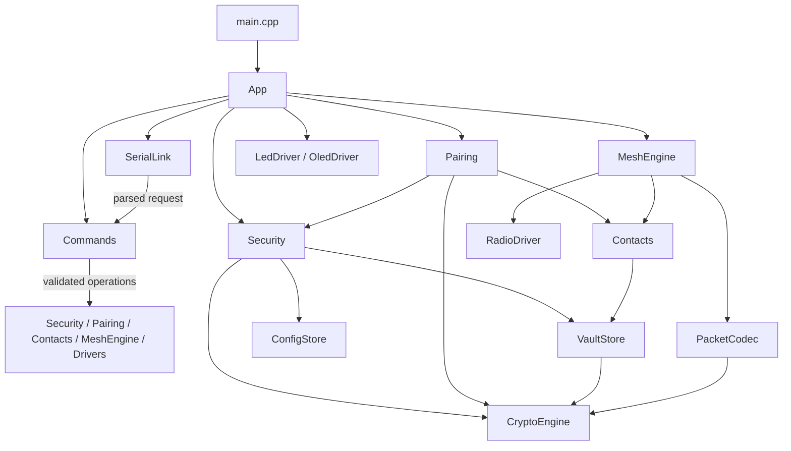

# Offgrid Firmware Architecture v1

> **Status:** Draft v1, simplified implementation structure
> **Hardware:** Heltec WiFi LoRa 32 V3 (ESP32-S3, SX1262, SSD1306), optional external strips with unconfirmed wiring; no application button
> **Execution:** C++17, one cooperative application loop on Arduino/ESP-IDF
> **Companion specifications:** [Host interface](offgrid-link.md) and [over-the-air protocol](offgrid-protocol.md)

> **Development exception:** During [serial mock development](../src/host/README.md),
> `App` owns serial wiring, UI drivers and the temporary `host/MockDevice.h` backend.
> `main.cpp` only delegates to App. Mock behavior stays outside the reusable
> transport/parser modules. See the [UI handoff](app-core-handoff.md).

## 1. Design Rules

Use a small number of cohesive modules rather than a class for every helper.
The previous design had 36 header/source pairs; this buttonless design has 14. No host
commands, protocol features, security requirements, or UI features are removed.
The companion specifications remain the source of truth for wire formats,
command arguments, defaults, limits, errors, and events.

- Match file names to their main class: `LedDriver.h`, `LedDriver.cpp`, `LedDriver`.
- Use short lowercase directory names and PascalCase class/file names.
- Keep private helpers, small structs, and internal state machines in the owning
  module. They do not need separate files or public classes.
- Pass dependencies explicitly. `App` owns the long-lived instances; avoid hidden
  global services and heap-allocated application objects.
- Keep `main.cpp` limited to constructing `App` and calling `init()` and `tick()`.
- Use `tick(now_ms)` only for modules with ongoing work. Pure utilities such as
  `PacketCodec` and `CryptoEngine` do not need an empty tick method.
- Avoid application-level waits, `delay()`, and unbounded work in the loop.
  Use deadlines, bounded queues, and completion notifications.
- Prefer proven libraries behind hardware/crypto wrappers. Audit their timing,
  memory allocation, and error behavior before promising non-blocking operation.
- Use fixed-capacity application buffers. Preallocate reusable library contexts
  where supported; measure framework/library allocation rather than claiming
  that the entire ESP32 runtime never allocates after startup.

Arduino/ESP-IDF uses FreeRTOS internally. This design introduces no additional
application tasks: application decisions run in one cooperative context. ISRs
only signal work; SPI, I2C, JSON processing, and flash access happen outside ISRs.

## 2. Directory Structure

This is the target structure, not a claim that these files already exist.
Create modules as they become functional; do not add empty scaffolding for all
modules at once. Button support is cancelled. Headers stay next to their implementation in `src/`.

```text
firmware/
|-- platformio.ini
|-- README.md
|-- docs/
|   |-- offgrid-firmware-architecture_v1.md
|   |-- offgrid-link.md
|   `-- offgrid-protocol.md
`-- src/
    |-- main.cpp
    |-- App.h / App.cpp
    |-- BoardConfig.h
    |-- Types.h
    |-- drivers/
    |   |-- RadioDriver.h / RadioDriver.cpp
    |   |-- LedDriver.h / LedDriver.cpp
    |   `-- OledDriver.h / OledDriver.cpp
    |-- host/
    |   |-- SerialLink.h / SerialLink.cpp
    |   `-- Commands.h / Commands.cpp
    |-- security/
    |   |-- CryptoEngine.h / CryptoEngine.cpp
    |   |-- Security.h / Security.cpp
    |   |-- Contacts.h / Contacts.cpp
    |   `-- Pairing.h / Pairing.cpp
    |-- storage/
    |   |-- ConfigStore.h / ConfigStore.cpp
    |   `-- VaultStore.h / VaultStore.cpp
    `-- mesh/
        |-- PacketCodec.h / PacketCodec.cpp
        `-- MeshEngine.h / MeshEngine.cpp
```

There are 28 module files plus `main.cpp`, `BoardConfig.h`, and `Types.h`.
The temporary `host/MockDevice.h` adapter is additional development-only code,
not a new permanent domain module in this target structure.
No separate `core/`, `ui/`, `radio/`, `handlers/`, or generic `utils/` directory
is needed. A driver here is the complete peripheral-facing module, including its
small state machine and presentation logic, not necessarily a register-only HAL.

`BoardConfig.h` contains verified pins, pixel counts, serial selection/baud,
hardware defaults, and fixed capacities. `Types.h` contains only genuinely shared
value types and enums. Module-private types stay in their module; persisted data
uses explicit, versioned encoding rather than raw C++ struct memory.

## 3. Module Responsibilities

### App

Owns instances, initializes dependencies, samples uptime once per loop, and drives
active modules. Lifecycle state lives in `Security`; `App` coordinates effects on
mesh, radio, and UI, and routes typed notifications to serial output and UI.
Home is the default page; pairing and error overlays expire automatically.

Use direct calls and a small set of fixed callbacks instead of a generic
`EventBus`. Callbacks run in the application context and do not perform hidden
long-running work. Shared notifications carry values, not pointers to temporary
buffers. A small private wrap-safe timing helper replaces `SystemClock`.

The current minimal App owns the mock backend instead of functional Security or
MeshEngine modules. It feeds secret-free `UiSnapshot` values, typed events and
copied LED settings/previews to independently initialized LED/OLED drivers.
OLED initialization/cooperative rendering and onboard/strip LED output are
implemented. Driver failure never stops the other modules. UI ticks continue when
native USB is disconnected. `sys.status.result.ui` exposes readiness and page.

### RadioDriver

Owns all SX1262 operations: SPI/init, TCXO, RF switch, DIO1 IRQ handling,
RX/TX/CAD state, timeouts, recovery, modem settings, presets, sync word expansion,
and PHY statistics. Airtime calculation is a method in this module.

Only `RadioDriver` accesses radio hardware. `MeshEngine` requests operations and
receives RX, TX-complete, CAD-result, and failure notifications. Configuration
changes wait for a safe hardware state. Register access and airtime helpers stay
private; there is no separate manager or calculator class.

The current wrapper uses pinned RadioLib 7.8.1, typed configuration/events and
instance-owned ISR signaling. The radio_diag builds wire it through the temporary
mock adapter for raw PHY checks while default builds retain the Android mock.
RadioLib packet staging plus a bounded SX1262 launch avoids the convenience
launcher's unbounded BUSY wait. See the [radio README](../src/drivers/README.md)
for operation deadlines, timing caveats and two-board device acceptance.

### LedDriver

Owns the onboard PWM LED and both external NeoPixel strips. Includes PWM/RMT
setup, stable transfer buffers, brightness/gamma handling, built-in and custom
patterns, state animations, event overrides, RF animations and preview.
Applies `enabled`, `quiet`, and brightness to the appropriate
outputs as specified. State and event timing remain separate internally.

Keep PWM, pixel transfer, and animation helpers private. An in-flight RMT buffer
must not be modified; skip or defer a frame when the transport is busy. No
separate strip-driver or animator files are required for two fixed strips.

### OledDriver

Owns SSD1306 power/reset/init, framebuffer, dirty-region transfers, text/icons,
and page rendering. Includes home/security status, RF telemetry, pairing expiry
and a timed fingerprint overlay. Receives a display snapshot and UI notifications, never
private keys.

Refresh presentation only when needed; send bounded chunks independently of the
render rate. Measure actual I2C transfer time before choosing the chunk size.
There is no separate renderer class.

### Buttonless hardware

Never configure or poll GPIO0 for application input. No page cycling or physical
reset confirmation exists. Secure profiles require fresh action-bound app-token
proof or an owner-signed single-use reset challenge. The owner private key is
external; only the public trust key enters firmware. See host section 6.11 for the
approved recovery contract. Legacy mocks return `E_BUSY` without erasing.

### SerialLink

Owns serial initialization, connection handling where supported, bounded RX/TX
buffers, line framing, JSON parsing/serialization, response envelopes, and event
formatting. Enforces the 2048-byte wire limit including LF, handles trailing CR,
discards oversized input through the next LF, and emits the specified errors.

Delivers one parsed request at a time to `Commands`. Queues complete outbound
lines without interleaving them, reserves capacity for responses, and throttles
expendable logs/traces under backpressure. Parsed views are valid only during
dispatch; deferred operations copy the bounded data they require. No raw debug
prints are permitted on the API transport.

### Commands

Owns command lookup, argument/type/range validation, state access checks, and
delegation to domain modules. Uses private handler methods grouped by namespace,
not six additional handler classes. All namespaces remain supported:

| Commands | Implementation destination |
|---|---|
| `sys.*` | System actions coordinated through `App` callbacks, security/session queries, serial logging policy |
| `sec.*` | `Security`, with coordinated lock/unlock/reset effects |
| `id.*` | `Security` identity access and persistence |
| `pair.*` | `Pairing` |
| `contact.*` | `Contacts`, with mesh cleanup on deletion/replacement |
| `msg.*` | `MeshEngine` |
| `radio.*` | `RadioDriver`, configuration persistence through `ConfigStore` |
| `mesh.*` | `MeshEngine`, configuration persistence through `ConfigStore` |
| `led.*` | `LedDriver`, configuration persistence through `ConfigStore` |
| `dbg.rf_trace` | Lab-only trace control and `SerialLink` events |

Keep business logic in the destination module. Set operations validate the full
candidate before applying changes; persistent operations report storage failures.
Long-running commands have an explicit pending/completion state, exactly one
response, and preserve command execution order without blocking peripheral ticks.
Do not retain JSON document references between ticks. Contact pagination must
also respect actual serialized output size, not just a contact-count limit.

### CryptoEngine

Provides RNG, SHA-256, HMAC, HKDF-SHA256, X25519, AES-256-GCM, AES-128-CCM,
and secure zeroization through ESP-IDF/Mbed TLS. It rejects all-zero DH results
and propagates crypto failures. The bundled ESP32-S3 SDK does not link its direct
HKDF entry point and its PSA HKDF provider reports `NOT_SUPPORTED`; the current
HKDF implementation follows RFC 5869 extract/expand using Mbed TLS HMAC and is
checked against RFC and protocol vectors on-device. SipHash is deferred until a
vetted implementation is selected for MeshEngine; do not handwrite a primitive.
CryptoEngine contains no device state, pairing policy, JSON, flash access, or
radio scheduling.

### Security

Owns unprovisioned/locked/unlocked state, decrypted identity, display name and
NodeID, ephemeral unlock sessions, token unwrapping, authentication backoff,
security policy and host-activity timeout. Coordinates
provisioning/unlock and token rotation with `VaultStore` and `ConfigStore`.

Consumes handshake sessions according to the host specification and zeroizes
ephemeral secrets on every completion/failure path. Emits lifecycle requests or
notifications to `App` so lock also cancels pairing, wipes contact RAM and queued
plaintext, clears vault-key RAM, and changes radio mode. State becomes unlocked
only after the complete required vault load succeeds; failed loads wipe partial
results. Reset authorization uses an action-bound wrapped token or the owner
master signature. App executes the durably authorized reset only after its
response drains; interrupted reset resumes from a plaintext marker at boot.

### Contacts

Owns the fixed 32-slot decrypted contact table, public contact views, names,
directional keys, pending/active state, NodeID candidate lookup, TX counter
allocation/reservations, and 64-bit replay windows. Persists records through
`VaultStore`; promotes pending contacts after authenticated accepted traffic.

Commits reservations before counter use and never wraps the 24-bit counter.
Restoring contacts after lock/unlock must obey the same nonce-safety rules as
reboot. Replay state changes only after tag verification; persisted replay state
is restored conservatively. Deletion/replacement coordinates queued-message
failure before old keys are discarded. Wipe all decrypted slots on lock.

### Pairing

Owns the single active pairing salt, 300-second expiry, OG1 QR encoding/decoding,
peer validation, self-pair rejection, role-independent salt ordering, directional
key derivation, fingerprint generation, and collision warnings. Uses `Security`
for own identity, `CryptoEngine` for primitives, and `Contacts` for insertion or
replacement. Cancel, expiry, and lock wipe temporary pairing secrets.

### ConfigStore

Owns plaintext NVS access for radio, mesh, LED configuration, security policy,
vault salt, and active generation metadata. Includes defaults, versioned record
encoding, validation on load, persistence, and reset. NVS open/read/write helpers
remain private; a separate `NvsPartition` class is unnecessary.

The current implementation persists radio/mesh/LED settings and timeout policy
in one schema-1 `og_cfg/settings` blob. Separate `og_cfg/vault` metadata selects
the active encrypted generation; `og_cfg/reset` journals an authorized reset.
See the [storage module README](../src/storage/README.md) for current
interfaces, corruption handling, and the reset-rejection device check.

### VaultStore

Owns encrypted NVS records: vault check, identity, and individual contact slots.
Uses fresh IVs and the specified AES-GCM associated data. Holds the active vault
key only while unlocked and wipes it explicitly. No keys are returned through
host-facing record views.

Includes authenticated loading, corruption/failure handling, power-safe vault
creation, two-generation token rotation, recovery, and erasure. The new records
and salt must be durable before switching the active generation. Boot must never
silently interpret a corrupt provisioned vault as a fresh device. Specify NVS
namespace/partition layout and transaction ordering before implementation.

### PacketCodec

Owns header packing/validation, masked AD, nonce construction, payload encoding
and decoding for TEXT/REACTION/GEO, and data/ACK sealing and verification using
`CryptoEngine`. Handles lengths, reserved fields, and coordinate endpoint
clamping explicitly. Verification returns results; it does not mutate queues or
replay state. It knows nothing about JSON, radio hardware, or transmit timing.

### MeshEngine

Owns the protocol pipeline and all bounded mesh scheduling state: eight outbound
slots, ACK work, retry timers, per-boot keyed dedupe cache, relay slots, SNR-weighted
backoff, overhear cancellation, source/tag-failure rate limits, and mesh counters.
These are private structs and helper methods, not separate public modules.

Uses `Contacts`, `PacketCodec`, and `RadioDriver`. Handles all message types,
status events, cancellation, queue-full conditions, radio errors, retry exhaustion,
and own/ACK traffic priority over relay traffic. TX success is reported only on
hardware completion. Retry time starts from actual transmission completion.

Verify incoming ACKs without changing pending state, then pass replay checks,
then mark delivery. Duplicate retry data may cause a fresh ACK but never a second
delivery. Authenticated addressed traffic is not relayed; failed candidate
verification retains transit fallback for NodeID collisions. Do not rely on
`SRC == own_id` alone to identify self echoes, since NodeIDs may collide.

Lock clears secret-bearing queues and prevents further own-message transmission;
an already-transmitted frame cannot be recalled. Locked relay-only operation uses
only public routing data and plaintext radio/mesh configuration, never contact
keys. Unprovisioned radio remains off.

## 4. Dependency Direction



The diagram shows calls, not ownership. `App` owns all long-lived module
instances, including those not drawn as direct ownership arrows. Domain modules
report typed notifications through explicit callbacks; they do not depend on
`Commands`, JSON, or UI. `App` wires notifications to serial and presentation.
Keep configuration persistence explicit at command/lifecycle boundaries.

## 5. Loop, Timing, and Failure Rules

`App::tick()` samples uptime and services serial RX/command work,
security timeout state, pairing expiry, radio completions, mesh scheduling,
LED output, OLED chunks, and serial TX in a documented order. Recheck lifecycle
state before scheduling own RF traffic. Configuration or vault jobs advance in
bounded steps where supported; measure unavoidable library/flash stalls.

- Drain completions before scheduling another radio operation.
- Give every hardware wait a timeout and explicit recovery/failure path.
- Never let a slow host stall RF work; every buffer has a capacity and overflow policy.
- Keep status/error responses available when an optional peripheral fails.
- Keep ISR signaling race-safe; `volatile` alone is not synchronization.
- Do not draw or transmit from mutable buffers still used by hardware.
- Measure maximum loop duration, serial overruns, queue high-water marks, and
  allocation behavior under concurrent serial, flash, crypto, radio, and UI load.
- Treat display/animation rates as targets, not evidence of latency guarantees.
- Keep secret-free diagnostics; compile fixed-key fixtures and test controls out
  of normal images. Release debug commands remain disabled.

## 6. Parallel Work and Device Milestones

| Workstream | Files owned | First independently testable device result |
|---|---|---|
| Integration/host | `App`, `SerialLink`, `Commands`, shared headers | Upload, boot event, status/ping, strict framing, responsive loop |
| Security/storage | `CryptoEngine`, `Security`, `Contacts`, `Pairing`, stores | On-device crypto vectors, persistent config, real provisioning/unlock/pairing |
| Radio/mesh | `RadioDriver`, `PacketCodec`, `MeshEngine` | Two-board radio exchange, then encrypted direct messages, ACK/retry, mesh |
| UI/hardware | `LedDriver`, `OledDriver` | Display/status, confirmed LED outputs and automatic overlays |

Freeze shared types, callback signatures, buffer lifetimes, and operation results
before parallel implementation. Each contributor maintains private helpers in
their module. Shared `Commands` integration should use small coordinated changes;
domain contributors provide validated APIs rather than all editing its routing
at once. Do not split files merely because two people need work.

Keep the main branch uploadable throughout these milestones:

1. Board bring-up and serial diagnostics, with basic UI.
2. Persistent configuration, real secure lifecycle, and two-board radio bring-up.
3. Real pairing and encrypted direct TEXT/REACTION/GEO exchange.
4. ACKs, replay rejection, retries, cancellation, lock cleanup, and reboot safety.
5. Three-board relaying; four-board suppression and congestion checks.
6. Complete command/UI behavior, power-cut rotation/recovery, and mixed-load soak.

Use a host exerciser against real devices so development does not wait for the
Android UI. These are device acceptance milestones, not substitutes with mocked
security or success-only handlers. Full animation polish follows communication
correctness. Secure Boot, flash encryption, irreversible eFuses, signing/recovery,
and regulatory airtime controls remain a separate release-hardening gate.

## 7. Mapping From the Previous Design

| Previous files/classes | New home |
|---|---|
| `AppCoordinator`, `SystemClock`, `EventBus` | `App`, with local timing helpers and explicit callbacks |
| `StateMachine`, `UnlockSession`, `IdentityManager` | `Security` |
| `NvsPartition` | Private NVS helpers inside the two stores |
| `ConfigStore`, `VaultStore` | Kept separate with the same names |
| `CryptoEngine` | Kept with the same name |
| `ContactBook`, `PairingManager` | `Contacts`, `Pairing` |
| `Sx1262Driver`, `RadioManager`, `AirtimeCalculator` | `RadioDriver` |
| `PacketCodec` | Kept with the same name |
| `DedupeCache`, `RelayScheduler`, `PendingQueue`, `MeshEngine` | `MeshEngine` |
| `SerialLink`, `JsonCodec`, `EventEmitter` | `SerialLink` |
| `CommandDispatcher`, all six command handlers | `Commands` |
| `StatusLedDriver`, `NeoPixelStripDriver`, `NeoPixelAnimator` | `LedDriver` |
| `OledDriver`, `OledUiRenderer` | `OledDriver` |
| `ButtonInput` | Cancelled: no usable application button |

Split a module later only when it has a genuinely independent responsibility,
hardware variant, reusable component, or demonstrated maintenance problem. Fewer
files must not mean putting cryptography, storage transactions, or protocol rules
inside the command dispatcher or application wiring.