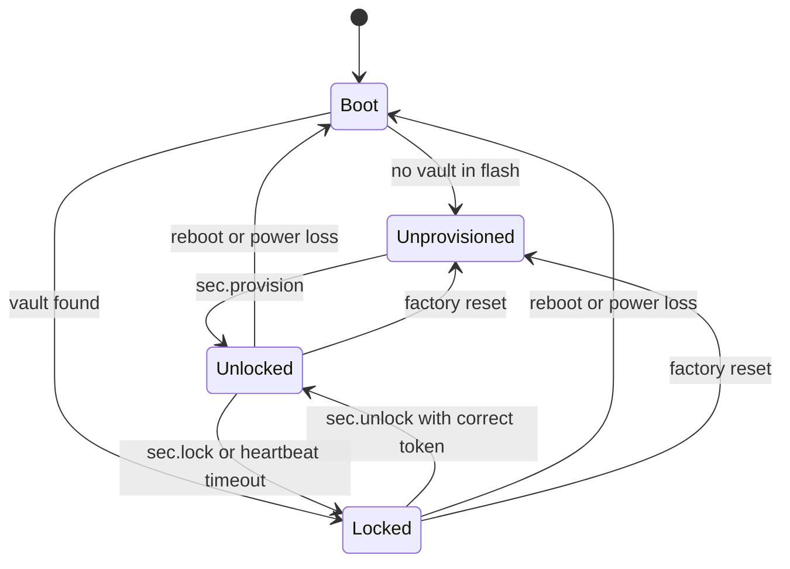
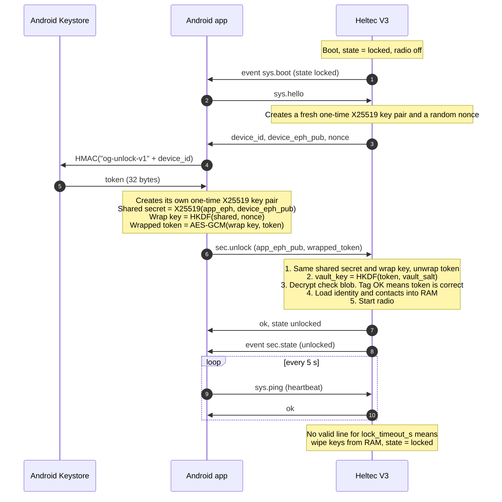
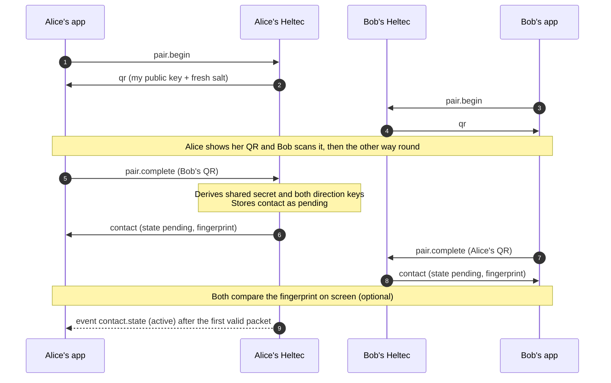

# Offgrid Host Interface v1: Android ⇄ Heltec V3 Serial API

> **Status:** Draft v1, for lab testing
> **Purpose:** JSON interface between the Offgrid Android app and the Heltec WiFi LoRa 32 V3 firmware
> **Transport:** USB serial, JSON Lines (one JSON object per line)
> **Companion document:** [Offgrid Protocol v1](offgrid-protocol.md), the over-the-air protocol this interface drives
> **Key idea:** The Heltec is a locked vault plus radio. All keys live on the Heltec, and it only works while the right phone has unlocked it.

---

## Table of Contents

1. [Purpose and Architecture](#1-purpose-and-architecture)
2. [Plain-Language Summary](#2-plain-language-summary-no-crypto-degree-required)
3. [Transport and Framing](#3-transport-and-framing)
4. [Message Envelope and Conventions](#4-message-envelope-and-conventions)
5. [Device States and Access Control](#5-device-states-and-access-control)
6. [Security: Keys, Lock and Unlock](#6-security-keys-lock-and-unlock)
7. [Command Reference](#7-command-reference)
8. [Event Reference](#8-event-reference)
9. [Error Codes](#9-error-codes)
10. [On-Device Storage](#10-on-device-storage)
11. [Session Examples](#11-session-examples)
12. [Limits and Constants](#12-limits-and-constants)
13. [Limitations and Future Work](#13-limitations-and-future-work)
14. [Appendix A: Android Token Derivation (Kotlin Sketch)](#appendix-a-android-token-derivation-kotlin-sketch)
15. [Appendix B: Unlock Reference Code (Python)](#appendix-b-unlock-reference-code-python)

---

## 1. Purpose and Architecture

```
┌──────────────────────────┐   USB serial, JSON Lines   ┌──────────────────────────────┐  LoRa  ┌────────────┐
│ Android app              │ ◄────────────────────────► │ Heltec WiFi LoRa 32 V3       │ ◄────► │ other      │
│  UI, chat history,       │      cleartext messages    │  keys, encryption, counters, │ cipher │ Offgrid    │
│  Keystore unlock secret  │                            │  mesh, radio, LED            │  text  │ nodes      │
└──────────────────────────┘                            └──────────────────────────────┘        └────────────┘
```

**Cleartext on the cable, ciphertext on the air.** The app talks plain JSON to the Heltec. The Heltec encrypts everything before it leaves the antenna.

### 1.1 Who owns what

| Responsibility | Heltec (device) | Android app |
|---|---|---|
| Identity private key | ✅ generated and stored, **never leaves the device** | ❌ |
| Contact keys (k_A→B, k_B→A) | ✅ derived and stored, never leave the device | ❌ |
| Encryption, tags, nonces, counters | ✅ | ❌ |
| Replay window, dedupe, relaying | ✅ | ❌ |
| Retries and ACK matching | ✅ | ❌ (only shows status events) |
| Radio, mesh and LED settings | ✅ stored in flash | sends changes |
| Message history, chat UI | ❌ (nothing stored) | ✅ |
| QR code rendering and scanning | ❌ (produces and parses the text) | ✅ |
| **Unlock secret** | ❌ (**never stored**) | ✅ (derived inside the Android Keystore) |

### 1.2 Design principles

1. **The device is a secure modem and vault.** It holds secrets and does protocol work, the app holds UI and history.
2. **Secrets never cross the cable.** The only secret that does is the unlock token, and it is wrapped (see [section 6.4](#64-unlock-handshake)).
3. **Human-readable JSON.** Bytes are scarce on the air, not on the cable.
4. **The device is useless while locked.** Without the phone's token the vault cannot be decrypted.
5. **One request, one response.** Everything asynchronous arrives as an event.

---

## 2. Plain-Language Summary (No Crypto Degree Required)

If you only read one section, read this one.

### The big picture

Think of the Heltec as a **small safe with a radio on top**.

- Inside the safe: your identity and the secret keys for every contact. They were created *inside* the safe and the safe never hands them out.
- The safe has a lock. The only key to it lives **in your phone**, in a special protected area (the Android Keystore) that apps cannot copy from.
- Every time the Heltec starts up, it is **locked** and cannot read its own keys. The phone has to "show its key" first. Only then can the safe open, switch on the radio and work.
- If the cable is pulled and the phone stops talking for a while, the safe **locks itself again** and wipes the keys from memory.

**Why the app can send cleartext JSON:** the cable is short and personal. The message only becomes unreadable gibberish once it passes through the safe and out the antenna.

### What the app can tell the safe to do

| You want to... | The app sends... |
|---|---|
| Set up a new Heltec | `sec.provision` (the safe makes its identity and locks itself to your phone) |
| Open the safe after boot | `sec.unlock` |
| Add a friend | `pair.begin` (show my QR), `pair.complete` (scan theirs) |
| Send a message | `msg.send` |
| Change the radio | `radio.set` |
| Change the LED blinking | `led.set` |

### What comes back

- **Responses**: "OK, done" or "no, because...", always tied to your request by an `id`.
- **Events**: things that just happen, like "a message arrived" or "your message was confirmed".

### Cheat sheet

| Concept | Everyday analogy | Technical name |
|---|---|---|
| Heltec | Safe with a radio | Device / vault |
| Phone's Keystore secret | A key that can never be copied out of the phone | Non-exportable HMAC key |
| Unlock token | The key's "fingerprint" for this one safe | `HMAC(K_phone, device_id)` |
| Wrapped token | Handing the key over in a sealed envelope | X25519 + AES-GCM wrap |
| Provisioning | Buying a new safe and setting its lock | `sec.provision` |
| Auto-lock | Safe closes when you walk away | Heartbeat timeout |
| Factory reset | Melting the safe down and starting over | `sys.factory_reset` |

---

## 3. Transport and Framing

### 3.1 Physical link

| Parameter | Value |
|---|---|
| Link | USB serial (USB-OTG host on Android, for example with *usb-serial-for-android*) |
| Baud rate | 115200 by default, fixed at build time (921600 is fine for the V3's USB-UART bridge) |
| Format | 8N1, no flow control |
| Alternative later | BLE UART with identical framing |

### 3.2 Framing: JSON Lines

- One JSON object per line, terminated by `\n` (LF). The device tolerates a trailing `\r` from the app.
- UTF-8, standard JSON escaping (RFC 8259). No raw newlines inside strings, no pretty-printing.
- **Max line length: 2048 bytes** including the newline, in both directions.
- Lines that are too long are discarded up to the next newline, and the device emits an `error` event (`E_LINE_TOO_LONG`).
- Invalid JSON gets `{"ok":false,"error":{"code":"E_PARSE",...}}` (without an `id`, because none could be read).

### 3.3 Practical pitfalls (read these)

| Pitfall | What happens | Handling |
|---|---|---|
| **DTR/RTS auto-reset** | Opening the port can toggle DTR/RTS and **reset the ESP32** | App sets DTR and RTS low immediately after opening. If a reboot happens anyway the app sees `sys.boot` |
| **ROM boot output** | The ESP32 ROM prints boot text at 115200 baud before the firmware starts | App **ignores every line that does not start with `{`** |
| **Stray debug prints** | `printf` or ESP-IDF logs would corrupt the stream | Firmware must route all logs through `log` events or disable them. No raw prints in production builds |
| **Half-line on connect** | The app may attach mid-line | Device sends one empty `\n` at boot. App drops everything up to the first `\n` after connecting |
| **Boot race** | Commands sent during boot are lost | App waits for `sys.boot` or retries `sys.hello` every 500 ms until answered |

---

## 4. Message Envelope and Conventions

Three kinds of lines exist.

### 4.1 Request (app → device)

```json
{"id": 12, "cmd": "msg.send", "args": {"to": 1, "type": "text", "text": "Hello!"}}
```

| Field | Type | Required | Description |
|---|---|---|---|
| `id` | integer | yes | Chosen by the app, unique among in-flight requests. Echoed in the response |
| `cmd` | string | yes | `namespace.verb` |
| `args` | object | no | Command arguments. May be omitted when a command takes none |

### 4.2 Response (device → app)

Success:

```json
{"id": 12, "ok": true, "result": {"msg_ref": 1, "state": "queued"}}
```

Failure:

```json
{"id": 12, "ok": false, "error": {"code": "E_TOO_LONG", "message": "text is 91 bytes, max is 83", "field": "text"}}
```

| Field | Type | Description |
|---|---|---|
| `error.code` | string | Stable machine-readable code ([section 9](#9-error-codes)) |
| `error.message` | string | Human-readable detail, for logs only, never parse it |
| `error.field` | string | Offending argument, where applicable |

### 4.3 Event (device → app)

```json
{"evt": "msg.received", "t": 152340, "data": {"from": 1, "type": "text", "text": "Hello!"}}
```

`t` is the device's monotonic uptime in milliseconds. The device has no wall clock, so the app timestamps messages itself.

### 4.4 Rules

| Rule | Detail |
|---|---|
| Ordering | The device executes commands **strictly in the order received** and sends exactly one response per request. Events can appear between any two lines |
| In-flight limit | The app should keep at most 4 requests in flight |
| Unknown fields | Ignored (forward compatibility) |
| Missing or wrong-typed required fields | `E_INVALID_ARG` with `field` set. Types are strict, so `"5"` is not `5` |
| Partial updates | All `*.set` commands accept any subset of fields, validate **all-or-nothing**, and return the complete new configuration |
| Persistence | `*.set` commands accept `"persist": true` (default) to save to flash, `false` to apply until the next reboot only |
| Timeouts | The app should wait 2 s for normal commands and 5 s for commands touching the vault (`sec.*`, `pair.complete`, `contact.delete`) |
| Versioning | `sys.hello` reports `proto` as `"major.minor"`. Minor changes only add fields and commands. A major change breaks compatibility |

### 4.5 Data types

| Kind | JSON encoding | Example |
|---|---|---|
| Raw bytes (keys, tokens) | Base64, standard alphabet, with padding | `"QO2IFVAq..."` |
| Node ID | 4 uppercase hex characters | `"E841"` |
| Device ID | 12 uppercase hex characters (base MAC address) | `"7CDFA100ABCD"` |
| Contact ID | Integer 1 to 32, local slot number | `1` |
| Message reference (`msg_ref`) | Integer, local handle, unique since boot | `17` |
| Counter (`ctr`) | Integer 0 to 16777215 | `1` |
| Coordinates | Decimal degrees as numbers | `47.0517` |
| Text | UTF-8 string | `"Hello!"` |
| Emoji | The emoji character itself | `"👍"` |
| Optional value that is absent | `null` | `"alt_m": null` |

---

## 5. Device States and Access Control



| State | Meaning | Radio |
|---|---|---|
| `unprovisioned` | Fresh device, no identity, no vault | Off |
| `locked` | Vault exists but is encrypted, no key in RAM | Off (or relay-only if `mesh.relay_when_locked` is true) |
| `unlocked` | Vault decrypted in RAM, device fully working | On |

### 5.1 Which commands work in which state

| Command | unprovisioned | locked | unlocked |
|---|:-:|:-:|:-:|
| `sys.hello`, `sys.status`, `sys.ping`, `sys.reboot`, `sys.factory_reset`, `sys.set_log_level` | ✅ | ✅ | ✅ |
| `sec.provision` | ✅ | ❌ | ❌ |
| `sec.unlock` | ❌ | ✅ | ❌ |
| `sec.lock`, `sec.rotate_token`, `sec.get_policy`, `sec.set_policy` | ❌ | ❌ | ✅ |
| `id.*`, `pair.*`, `contact.*`, `msg.*` | ❌ | ❌ | ✅ |
| `radio.get`, `mesh.get`, `led.get` | ✅ | ✅ | ✅ |
| `radio.set`, `radio.stats`, `mesh.set`, `led.set`, `led.test`, `dbg.rf_trace` | ❌ | ❌ | ✅ |

A command in the wrong state gets `E_LOCKED` or `E_NOT_PROVISIONED` (or `E_ALREADY_PROVISIONED` and `E_ALREADY_UNLOCKED` for the opposite cases).

---

## 6. Security: Keys, Lock and Unlock

### 6.1 What "unusable without the right Android device" means

| Protected | How |
|---|---|
| Identity private key and contact keys at rest | Encrypted in flash under a key that exists **only** while the phone is connected |
| Sending, receiving, reading contacts | Impossible while locked. There is no key to do crypto with |
| Another phone | Cannot produce the token. The token comes from a key that never leaves the original phone's Keystore |
| A cloned or flashed device | Flash contents are useless without the token |

| **Not** protected | Note |
|---|---|
| The firmware code itself | Not a secret. Use Secure Boot to stop modified firmware ([section 6.8](#68-lab-vs-release-hardening)) |
| An attacker who has the unlocked device **and** can read RAM | Keys are in RAM while unlocked |
| Active man-in-the-middle on the cable during unlock | See [section 6.9](#69-limitations) |

### 6.2 Key hierarchy

```
 Android Keystore (hardware-backed, non-exportable)
   K_phone ─────────────────────────────┐
                                        ▼
   unlock_token = HMAC-SHA256(K_phone, "og-unlock-v1" || device_id)     32 bytes, per device
                                        │      sent to the device only inside a wrapped envelope
                                        ▼
   vault_key = HKDF-SHA256(token, salt = vault_salt, info = "og-vault-v1")   32 bytes, RAM only
                                        │
                                        ▼
   AES-256-GCM encrypts every vault entry in flash:
     identity private key · contact keys · counters · contact names
```

- `device_id` is the base MAC address of the ESP32-S3 (returned by `sys.hello`). Mixing it in means a token for one device is useless on another.
- `vault_salt` is random, stored in plaintext next to the vault.
- The device **never stores the token or vault_key**. After a reboot the vault is just encrypted data.

### 6.3 Provisioning (first use)

1. App calls `sys.hello`, which returns the device's ephemeral public key and nonce.
2. App derives the token, wraps it ([6.5](#65-wrapping-format)) and calls `sec.provision`.
3. The device generates its identity key pair with the hardware RNG, generates `vault_salt`, derives the `vault_key` and writes the encrypted vault plus a small **check blob** (a known string encrypted under the vault key, used later to verify unlock attempts).
4. State becomes `unlocked`. The response carries the node ID and public key.

The identity private key is created *inside* the device and never exported.

### 6.4 Unlock handshake



Why the wrapping step exists: it stops someone who sniffs the USB cable from simply reading the token. The ephemeral keys are used **once** and discarded, so a recorded unlock exchange cannot be replayed.

### 6.5 Wrapping format

```
shared       = X25519(app_eph_private, device_eph_public)
wrap_key     = HKDF-SHA256(ikm = shared, salt = nonce, info = "og-unlock-wrap-v1" || device_id_bytes, L = 32)
wrapped      = iv (12 B, random) || AES-256-GCM(wrap_key, iv, plaintext = token, aad = device_id_bytes)
                                  └─ ciphertext (32 B) || tag (16 B)
```

`wrapped_token` in JSON is the Base64 of these **60 bytes**. `device_id_bytes` are the 6 raw bytes of the 12-hex-character device ID. A full worked vector is in [section 11.1](#111-first-time-setup-provisioning) and the reference code in [Appendix B](#appendix-b-unlock-reference-code-python).

### 6.6 Lock triggers

The device locks when **any** of these happens:

| Trigger | Detail |
|---|---|
| `sec.lock` | Explicit |
| **Heartbeat timeout** | No valid line from the app for `lock_timeout_s` (default 15 s, configurable, 0 disables). Any valid command counts as activity, `sys.ping` is the dedicated heartbeat |
| Reboot or power loss | Always boots into `locked` |
| `sys.factory_reset` | Wipes everything |

On lock the device: zeroes the keys in RAM, fails all in-flight messages (`msg.status` with `failed`, reason `locked`), clears the queue and stops the radio. If `mesh.relay_when_locked` is true the radio keeps running as a **keyless relay** (see [Offgrid Protocol §11](offgrid-protocol.md): relays never need keys).

### 6.7 Failed unlocks

| Rule | Detail |
|---|---|
| Single use sessions | Every `sys.hello` creates a new session. A `sec.unlock` or `sec.provision` attempt, successful or not, **consumes** it. Retrying requires a new `sys.hello` |
| No information leak | A wrong token, a wrong device or a corrupted envelope all return the same `E_UNLOCK_FAILED` |
| Rate limiting | After 3 consecutive failures the device answers `E_RATE_LIMITED` for 2 s, doubling each time up to 60 s |
| No wipe on failure | The token has 256 bits of entropy, so guessing is hopeless. A wipe-on-failure rule would only create a denial-of-service trap |

### 6.8 Lab vs release hardening

| Measure | Lab build | Release build |
|---|---|---|
| Vault encryption (AES-256-GCM, this document) | ✅ | ✅ |
| **Secure Boot v2** (only signed firmware runs) | optional | ✅ so nobody can flash firmware that dumps secrets |
| **Flash encryption** | optional | ✅ |
| Disable JTAG, USB-JTAG and ROM download mode (eFuses) | no | ✅ |
| Debug commands (`dbg.*`) | on | compile out |

eFuse settings are **irreversible**, so enable them only on devices you are happy to sacrifice.

### 6.9 Limitations

- **Active man-in-the-middle on the cable.** The wrap uses an unauthenticated ephemeral exchange, so it defeats passive sniffing but not a device that sits in the middle and impersonates the Heltec. Optional hardening is a device attestation key pinned by the app at provisioning time.
- **Lost or wiped phone.** If the Keystore key is gone, the token is gone and the device can only be factory-reset. This is by design. A recovery mechanism is future work.
- **Cleartext messages on the cable** are visible to anything that can tap the USB link.
- **RAM while unlocked** holds the keys.

### 6.10 Changing phones

`sec.rotate_token` (device unlocked) replaces the token. The new phone cannot do this alone, because it cannot unlock the device in the first place. Moving a device to a new phone therefore needs the old phone's help or a factory reset.

### 6.11 Factory reset

Always possible, so a lost phone does not leave a bricked device, and it needs **physical presence**:

1. App calls `sys.factory_reset` with `"confirm": "ERASE"`. The device arms the reset for 10 s.
2. The user holds the PRG button for 3 s.
3. The device wipes the vault, configuration and counters and reboots into `unprovisioned`.

All keys and contacts are gone. A thief can reuse the hardware but gets none of your data.

---

## 7. Command Reference

Conventions: **State** lists where the command works ([section 5.1](#51-which-commands-work-in-which-state)). Fields marked ✱ are required.

### 7.1 System (`sys.*`)

#### `sys.hello`
Handshake. Starts a new session and returns device info. **Call this first after every connect or boot.**

| Arg | Type | Description |
|---|---|---|
| `app` | string | App name, for logs |
| `app_proto` | string | Protocol version the app speaks, for example `"1.0"` |

Result:

| Field | Description |
|---|---|
| `device`, `chip`, `device_id` | Board name, chip, base-MAC device ID |
| `fw` | `{version, build}` |
| `proto` | Protocol version of the firmware |
| `state` | `unprovisioned`, `locked` or `unlocked` |
| `session` | `{device_eph_pub, nonce}` for the next `sec.*` wrap. A new one on every call |
| `limits` | `{max_line, max_contacts, max_text_bytes, pending_queue}` |

```json
→ {"id":1,"cmd":"sys.hello","args":{"app":"offgrid-android","app_proto":"1.0"}}
← {"id":1,"ok":true,"result":{"device":"heltec_wifi_lora_32_v3","chip":"ESP32-S3","device_id":"7CDFA100ABCD","fw":{"version":"0.1.0","build":"2026-10-22"},"proto":"1.0","state":"locked","session":{"device_eph_pub":"3F3+lep6lCFDIkWOsKWMD23g3Q35wH80fqT/H8cS0n4=","nonce":"YGFiY2RlZmdoaWprbG1ubw=="},"limits":{"max_line":2048,"max_contacts":32,"max_text_bytes":83,"pending_queue":8}}}
```

Errors: `E_PROTO_MISMATCH` (major version differs).

#### `sys.status`
Runtime snapshot. Works in every state, with fewer fields when not unlocked.

| Result field | Description |
|---|---|
| `state`, `uptime_ms`, `reset_reason` | |
| `heap_free`, `battery_mv` | `battery_mv` is `null` if not measurable |
| `radio` | `{running, relay_only}` |
| `queue` | `{pending, capacity}` (unlocked only) |
| `contacts` | `{used, capacity}` (unlocked only) |
| `security` | `{secure_boot, flash_encryption}` |

```json
→ {"id":2,"cmd":"sys.status"}
← {"id":2,"ok":true,"result":{"state":"unlocked","uptime_ms":482113,"reset_reason":"power_on","heap_free":172304,"battery_mv":4012,"radio":{"running":true,"relay_only":false},"queue":{"pending":0,"capacity":8},"contacts":{"used":1,"capacity":32},"security":{"secure_boot":false,"flash_encryption":false}}}
```

#### `sys.ping`
Heartbeat and activity signal. Resets the auto-lock timer.

```json
→ {"id":3,"cmd":"sys.ping"}
← {"id":3,"ok":true,"result":{"uptime_ms":487120}}
```

#### `sys.reboot`
Sends the response, then restarts. The device comes back `locked`. A `sys.boot` event follows.

#### `sys.factory_reset`
Arms a factory reset ([section 6.11](#611-factory-reset)). Without `"confirm": "ERASE"` it fails with `E_CONFIRM_REQUIRED`.

```json
→ {"id":4,"cmd":"sys.factory_reset","args":{"confirm":"ERASE"}}
← {"id":4,"ok":true,"result":{"armed":true,"expires_s":10,"action":"hold PRG button for 3 s"}}
```

#### `sys.set_log_level`
| Arg | Description |
|---|---|
| `level` ✱ | `off`, `error`, `warn`, `info`, `debug` |

Logs arrive as `log` events and **never contain keys or token material**.

---

### 7.2 Security (`sec.*`)

#### `sec.provision`
**State: unprovisioned.** Sets up the device and locks it to this phone ([section 6.3](#63-provisioning-first-use)).

| Arg | Type | Description |
|---|---|---|
| `app_eph_pub` ✱ | base64 | The app's one-time X25519 public key |
| `wrapped_token` ✱ | base64 | 60-byte wrapped token ([6.5](#65-wrapping-format)) |
| `name` | string | Display name, max 24 bytes UTF-8. Default `Offgrid-XXXX` |

Result: `{node_id, public_key, name, state}`.
Errors: `E_ALREADY_PROVISIONED`, `E_NO_SESSION`, `E_UNLOCK_FAILED`, `E_INVALID_ARG`.

#### `sec.unlock`
**State: locked.** Opens the vault ([section 6.4](#64-unlock-handshake)). Arguments as in `sec.provision`, without `name`.

Result: `{state, node_id, name, contacts, radio: {running, relay_only}}`.
Errors: `E_NOT_PROVISIONED`, `E_ALREADY_UNLOCKED`, `E_NO_SESSION`, `E_UNLOCK_FAILED`, `E_RATE_LIMITED`.

#### `sec.lock`
**State: unlocked.** Locks immediately ([section 6.6](#66-lock-triggers)). Result: `{"state": "locked"}`.

#### `sec.rotate_token`
**State: unlocked.** Replaces the unlock token. The app first calls `sys.hello` for a fresh session, then sends the **new** token wrapped. The device re-encrypts the whole vault under a new `vault_salt` using a safe two-generation write (power loss mid-rotation keeps the old vault valid). Arguments as in `sec.unlock`. Result: `{"rotated": true}`.

#### `sec.get_policy` / `sec.set_policy`
**State: unlocked.**

| Field | Type | Range | Default | Description |
|---|---|---|---|---|
| `lock_timeout_s` | integer | 0 to 3600 | 15 | Auto-lock after this much silence. 0 disables (lab only) |

---

### 7.3 Identity (`id.*`)

**State: unlocked.**

#### `id.get`
Result: `{node_id, public_key, name}`. The private key is never returned.

#### `id.set_name`
| Arg | Description |
|---|---|
| `name` ✱ | Display name, 1 to 24 bytes UTF-8. Used in the next QR code you show |

---

### 7.4 Pairing and Contacts (`pair.*`, `contact.*`)

**State: unlocked.** Pairing is the QR key exchange from the protocol spec, done in person.

#### Pairing flow



#### `pair.begin`
Creates a fresh random pairing salt, stores it temporarily and returns your QR text.

Result: `{qr, qr_bytes, expires_s}`.

- `qr` is the Base64 of `"OG1" || public_key(32) || salt(16) || name`. **Render this string as the QR code text.**
- Only one pairing can be pending. A new `pair.begin` replaces the old one.
- Expires after 300 s.
- **Do not refresh your QR between being scanned and scanning the other side.** The salt must match what the other device received.

```json
→ {"id":20,"cmd":"pair.begin"}
← {"id":20,"ok":true,"result":{"qr":"T0cxLosog8J7ORNZ19DBXQCBWmaTKQo43Y66NBzAfdqo7U0QERITFBUWFxgZGhscHR4fQWxpY2U=","qr_bytes":56,"expires_s":300}}
```

#### `pair.cancel`
Discards the pending pairing. Result: `{"cancelled": true}`.

#### `pair.complete`
Processes the QR text scanned from the other person.

| Arg | Type | Description |
|---|---|---|
| `qr` ✱ | string | Scanned text from the peer |
| `name` | string | Override for the contact name (default: name from the QR) |
| `replace` | boolean | Re-pair an existing contact: resets counters and replaces keys. Default `false` |

Result: `{contact, warnings}`.

```json
→ {"id":21,"cmd":"pair.complete","args":{"qr":"T0cxwLEmtaoTS4TmRiUla43olzeHYSsfODnSxgUm0hFOiG0gISIjJCUmJygpKissLS4vQm9i"}}
← {"id":21,"ok":true,"result":{"contact":{"contact_id":1,"name":"Bob","node_id":"E841","public_key":"wLEmtaoTS4TmRiUla43olzeHYSsfODnSxgUm0hFOiG0=","state":"pending","fingerprint":"0501 3010 7790","tx_ctr":0,"rx_highest_ctr":null,"last_rssi":null,"last_snr":null},"warnings":[]}}
```

| Warning | Meaning |
|---|---|
| `node_id_collision` | Another contact has the same 16-bit node ID. Still works because the tag check disambiguates ([Protocol §11.1](offgrid-protocol.md)) |

Errors: `E_NO_PAIRING`, `E_INVALID_QR`, `E_SELF_PAIR`, `E_CONTACT_EXISTS`, `E_STORAGE_FULL`.

**Fingerprint:** `SHA256("og1-fp" || pub_low || pub_high)`, where the two public keys are sorted bytewise. The first 8 bytes are read as a big-endian number, taken modulo 10¹² and shown as three groups of four digits. Both phones show the same digits when pairing was not tampered with.

#### Contact object

| Field | Description |
|---|---|
| `contact_id` | Local slot 1 to 32, stable for the life of the contact |
| `name`, `node_id`, `public_key` | |
| `state` | `pending` until the first valid packet from the peer verifies, then `active` |
| `fingerprint` | See above |
| `tx_ctr` | Next outgoing counter (informational) |
| `rx_highest_ctr` | Highest verified counter received, `null` if none |
| `last_rssi`, `last_snr` | From the last valid packet, `null` if none |

Contact keys are **never** part of this object.

#### `contact.list`
| Arg | Default | Description |
|---|---|---|
| `offset` | 0 | |
| `limit` | 10 | Max 10, so one response stays under the line limit |

Result: `{total, offset, contacts: [...]}`.

#### `contact.get`
Arg `contact_id` ✱. Result: `{contact}`. Error: `E_NO_SUCH_CONTACT`.

#### `contact.rename`
Args `contact_id` ✱, `name` ✱ (max 24 bytes).

#### `contact.delete`
Args `contact_id` ✱, `confirm` ✱ (must be `true`). Securely erases the keys, counters and replay state. Pending messages to this contact fail with reason `contact_deleted`.

---

### 7.5 Messages (`msg.*`)

**State: unlocked.** Message types and on-air encoding are defined in [Offgrid Protocol §7 and §8](offgrid-protocol.md).

#### `msg.send`

Common arguments:

| Arg | Type | Description |
|---|---|---|
| `to` ✱ | integer | `contact_id` |
| `type` ✱ | string | `text`, `reaction` or `geo` |
| `ack` | boolean | Request a receipt. Default from `mesh.ack_default` for this type |
| `hops` | integer | 0 to 7. Default `mesh.hop_default` |

**Type `text`**

| Arg | Description |
|---|---|
| `text` ✱ | UTF-8, at most `limits.max_text_bytes` **bytes** (83 by default). Longer fails with `E_TOO_LONG`, and the app splits it |

**Type `reaction`**

| Arg | Description |
|---|---|
| `target` ✱ | `{author, ref}` |
| `target.author` | `"me"` if the target is a message *I* wrote, `"peer"` if the contact wrote it |
| `target.ref` | `ctr & 0xFFFF` of the target message (the app knows the full `ctr` from `msg.send` or `msg.received`) |
| `emoji` ✱ | Emoji from the table in [Protocol Appendix B](offgrid-protocol.md), or `null` to **remove** my reaction |

Mapping to the wire flag `TARGET_OWN` (target written by the *reacting* user): `author: "me"` sets it to 1, `author: "peer"` sets it to 0.

**Type `geo`**

| Arg | Description |
|---|---|
| `lat` ✱, `lon` ✱ | Decimal degrees. Encoded in 24 bits each |
| `alt_m` | Optional altitude in metres |
| `age_s` | Optional age of the fix in seconds (0 to 2550, rounded to 10 s) |

Result:

| Field | Description |
|---|---|
| `msg_ref` | Local handle for status events |
| `ctr` | Counter assigned to this message (the message ID within this conversation) |
| `ack_requested`, `hops` | Effective values |
| `state` | Always `queued` here |
| `bytes_on_air`, `est_airtime_ms` | Size and estimated airtime at the current radio settings |

```json
→ {"id":30,"cmd":"msg.send","args":{"to":1,"type":"text","text":"Hello!","ack":true}}
← {"id":30,"ok":true,"result":{"msg_ref":1,"ctr":1,"ack_requested":true,"hops":3,"state":"queued","bytes_on_air":23,"est_airtime_ms":206}}
```

```json
→ {"id":31,"cmd":"msg.send","args":{"to":1,"type":"reaction","target":{"author":"peer","ref":1},"emoji":"👍"}}
→ {"id":32,"cmd":"msg.send","args":{"to":1,"type":"geo","lat":47.0517,"lon":8.3075}}
```

Errors: `E_NO_SUCH_CONTACT`, `E_TOO_LONG`, `E_QUEUE_FULL`, `E_INVALID_ARG`, `E_LOCKED`.

The pending queue lives in RAM only, so after a reboot unfinished messages are gone. The app treats everything still pending at `sys.boot` as failed.

#### `msg.cancel`
Arg `msg_ref` ✱. Stops sending and retrying. A packet that has already been transmitted cannot be unsent. Result: `{"state": "cancelled"}`, then a `msg.status` event.

#### `msg.pending`
Result: `{pending: [{msg_ref, to, type, ctr, state, retry}]}`.

#### Message status values

| `state` | Meaning | UI |
|---|---|---|
| `queued` | Waiting for channel access | ⏳ |
| `sent` | Transmitted | ✓ |
| `relayed` | A neighbour was heard repeating it (implicit first-hop confirmation) | ✓ |
| `retrying` | No ACK yet, retransmitting (`retry` 1 to 3) | ✓ |
| `delivered` | End-to-end ACK verified | ✓✓ |
| `failed` | Gave up. `reason` is `timeout`, `locked`, `contact_deleted` or `radio_error` | ✗ |
| `cancelled` | Cancelled by `msg.cancel` | |

---

### 7.6 Radio (`radio.*`)

#### Radio configuration

| Field | Type | Range | Default | Description |
|---|---|---|---|---|
| `freq_mhz` | number | 150.0 to 960.0 | 869.525 | Carrier frequency. Match your board's antenna band |
| `bw_khz` | number | 62.5, 125, 250, 500 | 125 | Bandwidth |
| `sf` | integer | 5 to 12 | 9 | Spreading factor. Higher means longer range and much longer airtime |
| `cr` | integer | 5 to 8 | 5 | Coding rate 4/5 to 4/8 |
| `tx_power_dbm` | integer | -9 to 22 | 14 | Output power at the SX1262 |
| `preamble` | integer | 6 to 64 | 8 | Preamble symbols |
| `sync_word` | integer | 0 to 255 | 79 (`0x4F`) | Private network filter. Avoid 18 (`0x12`) and 52 (`0x34`) |
| `preset` | string | see below | none | Set-only shortcut that fills the fields above |

On the SX1262 the one-byte sync word is expanded to the chip's two-byte register by turning each nibble `n` into `(n << 4) | 0x4`, so `0x12` becomes `0x1424` and `0x4F` becomes `0x44F4`.

All nodes in a mesh must share frequency, bandwidth, SF, CR, preamble and sync word.

| Preset | Settings | Airtime for 23 B |
|---|---|---|
| `lab_default` | SF9, BW125, CR4/5, 14 dBm, 869.525 MHz | ca. 206 ms |
| `fast` | SF7, BW250 | ca. 31 ms |
| `long_range` | SF11, BW125 | ca. 823 ms |

#### `radio.get`
Works in every state. Result: the configuration above, plus `est_airtime_ms_23b` and `max_text_bytes`.

#### `radio.set`
**State: unlocked.** Accepts any subset of the configuration plus `persist`. Changes are applied after the current transmission finishes.

Result: full configuration, `est_airtime_ms_23b`, `warnings`.

| Warning | Meaning |
|---|---|
| `outside_eu868` | Frequency outside 863 to 870 MHz |
| `above_eu868_power_limit` | `tx_power_dbm` above 14 |
| `reserved_sync_word` | Sync word 0x12 or 0x34 collides with LoRaWAN |
| `mesh_incompatible` | Reminder that other nodes must be changed to match |

Warnings never block the change (this is a lab tool). Duty cycle is not enforced ([Protocol §4](offgrid-protocol.md)).

```json
→ {"id":40,"cmd":"radio.set","args":{"sf":10,"tx_power_dbm":17}}
← {"id":40,"ok":true,"result":{"freq_mhz":869.525,"bw_khz":125,"sf":10,"cr":5,"tx_power_dbm":17,"preamble":8,"sync_word":79,"est_airtime_ms_23b":371,"max_text_bytes":83,"warnings":["above_eu868_power_limit","mesh_incompatible"]}}
```

#### `radio.stats`
**State: unlocked.** Optional arg `reset` (boolean) clears the counters after reading.

| Counter | Meaning |
|---|---|
| `tx_packets`, `rx_packets` | Packets sent and received at PHY level |
| `rx_crc_errors` | PHY CRC failures |
| `rx_tag_failures` | Packets addressed to me whose tag did not verify |
| `rx_dedupe_drops` | Duplicates dropped |
| `relayed`, `relay_suppressed` | Packets forwarded and forwards cancelled because a neighbour was faster |
| `acks_sent`, `acks_received`, `retries` | |
| `tx_airtime_ms_total` | Accumulated transmit time since boot or reset |
| `last_rssi`, `last_snr` | |

---

### 7.7 Mesh (`mesh.*`)

Tunables of the relaying and retry behaviour from the protocol spec.

| Field | Type | Range | Default | Description |
|---|---|---|---|---|
| `hop_default` | integer | 0 to 7 | 3 | `HOP_START` for my own packets |
| `relay_enabled` | boolean | | true | Forward other nodes' packets |
| `relay_when_locked` | boolean | | false | Keep relaying (keyless) while locked. Off means the radio is fully off when locked |
| `cad_enabled` | boolean | | true | Listen before talk. Keep on, even in the lab |
| `backoff_slots` | integer | 0 to 32 | 8 | Random backoff window before relaying |
| `retries` | integer | 0 to 3 | 3 | Retransmissions of unacknowledged messages |
| `retry_base_ms` | integer | 0 to 60000 | 0 | Base retry timeout. 0 means automatic from airtime and hop count |
| `rate_limit_per_src` | integer | 0 to 255 | 20 | Max relayed packets per source per minute. 0 disables |
| `ack_default` | object | | `{text:true, reaction:false, geo:false}` | Default `ack` per type |

#### `mesh.get`
Works in every state. Result: the table above.

#### `mesh.set`
**State: unlocked.** Any subset plus `persist`. Result: full configuration.

```json
→ {"id":50,"cmd":"mesh.set","args":{"hop_default":5,"ack_default":{"geo":true}}}
```

---

### 7.8 LED (`led.*`)

The V3 has one user LED (GPIO35 on the V3, verify against your board revision), driven by PWM so brightness works. The display is not covered in v1.

#### LED configuration

| Field | Type | Default | Description |
|---|---|---|---|
| `enabled` | boolean | true | Master switch |
| `quiet` | boolean | false | Stealth mode, the LED never lights |
| `brightness` | integer 0 to 255 | 128 | PWM duty |
| `state_patterns` | object | see below | Pattern that **loops** while the device is in a state |
| `event_patterns` | object | see below | Pattern played **once** on top of the state pattern when an event happens |

State keys: `unprovisioned`, `locked`, `unlocked`.
Event keys: `tx`, `rx`, `msg_received`, `delivered`, `failed`, `error`, `pairing`.

| Key | Default |
|---|---|
| `state_patterns.unprovisioned` | `"pulse"` |
| `state_patterns.locked` | `"blink_slow"` |
| `state_patterns.unlocked` | `"off"` |
| `event_patterns.tx` | `"flash"` |
| `event_patterns.rx` | `"flash"` |
| `event_patterns.msg_received` | `"double"` |
| `event_patterns.delivered` | `"off"` |
| `event_patterns.failed` | `{"steps":[100,100],"repeat":3}` |
| `event_patterns.error` | `"blink_fast"` |
| `event_patterns.pairing` | `"heartbeat"` |

#### Patterns

A pattern is a **name** or a **custom object**.

| Name | Steps (ms, alternating on, off) | Notes |
|---|---|---|
| `off` | none | |
| `on` | none | Steady on |
| `flash` | `[60]` | Single short pulse |
| `blink_slow` | `[500, 500]` | |
| `blink_fast` | `[100, 100]` | |
| `double` | `[80, 80, 80, 760]` | Two short blinks |
| `heartbeat` | `[100, 150, 100, 650]` | |
| `pulse` | smooth fade, 1.5 s | PWM ramp up and down |

Custom: `{"steps": [on_ms, off_ms, ...], "repeat": N}`. Up to 16 entries of 10 to 10000 ms each. `repeat` applies to event patterns (default 1). State patterns always loop.

An event pattern temporarily overrides the state pattern, which then resumes.

#### `led.get`
Works in every state. Result: the configuration, plus `builtin_patterns`.

#### `led.set`
**State: unlocked.** Any subset plus `persist`. Nested objects merge, so setting one pattern leaves the others alone. Result: the full configuration.

```json
→ {"id":60,"cmd":"led.set","args":{"brightness":40,"state_patterns":{"locked":{"steps":[50,1950]}},"event_patterns":{"msg_received":{"steps":[200,100,200],"repeat":2}}}}
```

#### `led.test`
**State: unlocked.** Plays a pattern once for preview, without changing the stored configuration.

| Arg | Description |
|---|---|
| `pattern` ✱ | Name or custom object |
| `repeat` | Number of plays, default 1 |

---

### 7.9 Debug (`dbg.*`)

Lab helper, compiled out of release builds.

#### `dbg.rf_trace`
**State: unlocked.** Arg `enabled` ✱ (boolean). When on, every packet at the radio produces an `rf.tx` or `rf.rx` event with the raw bytes (see [section 8](#8-event-reference)). Raw packets are ciphertext, so no secrets leak. This lets you compare on-air bytes with the worked example in the protocol spec.

---

## 8. Event Reference

Events are never answered. Every event carries `t`, the uptime in milliseconds.

| Event | When | Needs state |
|---|---|---|
| `sys.boot` | After every start, and once on connect if the device is already running | any |
| `sec.state` | The state changed | any |
| `msg.received` | A message arrived and verified | unlocked |
| `msg.status` | A pending message changed state | unlocked |
| `contact.state` | A contact became `active` | unlocked |
| `rf.tx`, `rf.rx` | Raw packet trace, only with `dbg.rf_trace` | unlocked |
| `log` | Log line | any |
| `error` | Unsolicited error (for example a line that was too long) | any |

### `sys.boot`
```json
{"evt":"sys.boot","t":412,"data":{"device_id":"7CDFA100ABCD","fw":"0.1.0","proto":"1.0","state":"locked","reset_reason":"power_on"}}
```

### `sec.state`
```json
{"evt":"sec.state","t":3120,"data":{"state":"unlocked","reason":"unlock"}}
{"evt":"sec.state","t":96120,"data":{"state":"locked","reason":"heartbeat_timeout"}}
```
`reason`: `unlock`, `provision`, `lock`, `heartbeat_timeout`, `factory_reset`.

### `msg.received`

Common fields: `from` (contact_id), `type`, `ctr`, `hops` (hops travelled), `retry`, `rssi`, `snr`. A duplicate caused by a retransmission is **not** delivered again, the device only re-sends the ACK.

**Text**
```json
{"evt":"msg.received","t":152340,"data":{"from":1,"type":"text","ctr":1,"text":"Hello!","hops":1,"retry":0,"rssi":-92,"snr":7.5}}
```

**Reaction** (`target.author` is from *my* point of view)
```json
{"evt":"msg.received","t":160210,"data":{"from":1,"type":"reaction","ctr":2,"target":{"author":"me","ref":1},"emoji":"👍","hops":0,"retry":0,"rssi":-71,"snr":9.0}}
```
`emoji` is `null` when the contact removed their reaction.

**Geo**
```json
{"evt":"msg.received","t":171800,"data":{"from":1,"type":"geo","ctr":2,"lat":47.05169,"lon":8.30751,"alt_m":null,"age_s":null,"hops":1,"retry":0,"rssi":-95,"snr":5.0}}
```

### `msg.status`
```json
{"evt":"msg.status","t":2210,"data":{"msg_ref":1,"to":1,"state":"sent","retry":0}}
{"evt":"msg.status","t":2420,"data":{"msg_ref":1,"to":1,"state":"relayed","retry":0}}
{"evt":"msg.status","t":3052,"data":{"msg_ref":1,"to":1,"state":"delivered","retry":0,"hops":1,"rtt_ms":842}}
{"evt":"msg.status","t":40130,"data":{"msg_ref":2,"to":1,"state":"failed","retry":3,"reason":"timeout"}}
```

### `contact.state`
```json
{"evt":"contact.state","t":9120,"data":{"contact_id":1,"state":"active"}}
```

### `rf.tx` and `rf.rx`
```json
{"evt":"rf.tx","t":2210,"data":{"len":23,"hex":"6CE841E3F00000015D1D3FD92A3E04DA794024DB76ADBC","airtime_ms":206}}
{"evt":"rf.rx","t":3052,"data":{"len":16,"hex":"48E3F0E8410000017F15646B08384B1D","rssi":-90,"snr":6.5,"action":"ack_matched"}}
```
`action` values: `delivered`, `ack_matched`, `relayed`, `dropped_duplicate`, `dropped_tag`, `dropped_hop_limit`, `dropped_rate_limit`.

### `log` and `error`
```json
{"evt":"log","t":1200,"data":{"level":"info","msg":"radio started 869.525 MHz SF9"}}
{"evt":"error","t":5000,"data":{"code":"E_LINE_TOO_LONG","message":"line exceeded 2048 bytes and was dropped"}}
```

---

## 9. Error Codes

| Code | Meaning |
|---|---|
| `E_PARSE` | Line is not valid JSON |
| `E_LINE_TOO_LONG` | Line exceeded 2048 bytes |
| `E_UNKNOWN_CMD` | No such command |
| `E_INVALID_ARG` | Missing, mistyped or out-of-range argument (`field` says which) |
| `E_PROTO_MISMATCH` | Incompatible major protocol version |
| `E_LOCKED` | Command needs the device unlocked |
| `E_NOT_PROVISIONED` | Device has no vault yet |
| `E_ALREADY_PROVISIONED` | Device already has a vault |
| `E_ALREADY_UNLOCKED` | Already unlocked |
| `E_NO_SESSION` | No unconsumed `sys.hello` session, call `sys.hello` again |
| `E_UNLOCK_FAILED` | Wrong token, wrong device or corrupted envelope (deliberately indistinguishable) |
| `E_RATE_LIMITED` | Too many failed unlocks, wait and retry |
| `E_CONFIRM_REQUIRED` | Dangerous command missing its confirmation |
| `E_NO_PAIRING` | `pair.complete` without an active `pair.begin` |
| `E_INVALID_QR` | QR text has bad Base64, wrong magic or wrong length |
| `E_SELF_PAIR` | The QR contains my own public key |
| `E_CONTACT_EXISTS` | Public key already paired, use `replace: true` |
| `E_NO_SUCH_CONTACT` | Unknown `contact_id` |
| `E_STORAGE_FULL` | Contact slots or flash exhausted |
| `E_TOO_LONG` | Text exceeds the maximum size |
| `E_QUEUE_FULL` | Pending queue is full |
| `E_BUSY` | Operation cannot run right now |
| `E_RADIO` | Radio hardware error |
| `E_INTERNAL` | Unexpected firmware error |

---

## 10. On-Device Storage

Two areas in flash (NVS):

| Area | Content | Protection |
|---|---|---|
| `og_cfg` | Radio, mesh, LED configuration, policy, `vault_salt`, vault generation number | **Plaintext**, nothing secret. Radio settings stay readable so a locked relay-only node still works |
| `og_vault` | Identity key, contact slots, counters, check blob | Every entry AES-256-GCM under `vault_key`, `aad = namespace \|\| key \|\| generation` |

### Vault entries

| Entry | Content |
|---|---|
| `identity` | X25519 private key (32 B), display name |
| `contact/1` … `contact/32` | Public key, name, `k_out` (16 B), `k_in` (16 B), TX counter reservation, replay window state, state flag |
| `check` | Known string, used to verify an unlock |

Each contact is a separate entry, so frequent counter updates only rewrite a few bytes.

### Counter persistence

Matches the rules in [Offgrid Protocol §6 and §9.3](offgrid-protocol.md):

| Counter | Write rule |
|---|---|
| TX counter | Reserve `ctr + 256` before use. On unlock, resume from the reserved value |
| Replay `highest_ctr` | Persist about every 16 received messages |

Writes happen only while unlocked, because only then is the `vault_key` in RAM.

---

## 11. Session Examples

`→` is app to device and `←` is device to app. Every JSON line below is valid JSON. Cryptographic values are real output of the reference code in [Appendix B](#appendix-b-unlock-reference-code-python) and are **test vectors only**.

### 11.1 First-time setup (provisioning)

Test inputs: `device_id` = `7CDFA100ABCD`, `K_phone` = `b16d81c53a827d203b069dc197f382b07fadfb4b93ca0123051a3201da825185`.

```
Derived on the phone:
  token       = HMAC-SHA256(K_phone, "og-unlock-v1" || device_id bytes)
              = 40ed8815502a8e2c1bf211f072b6b881857e1735f77107f9dc828ef9d451ebe0
  app ephemeral public key       = eVqh8pkoQ2JZydkefYsuR1PE3/Qy12/DzPg2jWPBaSk=
  wrapped_token (60 bytes)       = cHFyc3R1dnd4eXp73iix4tUwvI3SCLdQkDcf6Ipj4SeWMvHCxsuoTYQbFZG8FDO6Y7fb7GfNujVODYXb
```

```json
← {"evt":"sys.boot","t":401,"data":{"device_id":"7CDFA100ABCD","fw":"0.1.0","proto":"1.0","state":"unprovisioned","reset_reason":"power_on"}}
→ {"id":1,"cmd":"sys.hello","args":{"app":"offgrid-android","app_proto":"1.0"}}
← {"id":1,"ok":true,"result":{"device":"heltec_wifi_lora_32_v3","chip":"ESP32-S3","device_id":"7CDFA100ABCD","fw":{"version":"0.1.0","build":"2026-10-22"},"proto":"1.0","state":"unprovisioned","session":{"device_eph_pub":"3F3+lep6lCFDIkWOsKWMD23g3Q35wH80fqT/H8cS0n4=","nonce":"YGFiY2RlZmdoaWprbG1ubw=="},"limits":{"max_line":2048,"max_contacts":32,"max_text_bytes":83,"pending_queue":8}}}
→ {"id":2,"cmd":"sec.provision","args":{"app_eph_pub":"eVqh8pkoQ2JZydkefYsuR1PE3/Qy12/DzPg2jWPBaSk=","wrapped_token":"cHFyc3R1dnd4eXp73iix4tUwvI3SCLdQkDcf6Ipj4SeWMvHCxsuoTYQbFZG8FDO6Y7fb7GfNujVODYXb","name":"Alice"}}
← {"id":2,"ok":true,"result":{"node_id":"E3F0","public_key":"Losog8J7ORNZ19DBXQCBWmaTKQo43Y66NBzAfdqo7U0=","name":"Alice","state":"unlocked"}}
← {"evt":"sec.state","t":1630,"data":{"state":"unlocked","reason":"provision"}}
```

(The device normally generates a random identity key. `public_key` here is the fixed test key from the protocol spec's worked example.)

### 11.2 Normal boot and unlock

```json
← {"evt":"sys.boot","t":398,"data":{"device_id":"7CDFA100ABCD","fw":"0.1.0","proto":"1.0","state":"locked","reset_reason":"power_on"}}
→ {"id":1,"cmd":"sys.hello","args":{"app":"offgrid-android","app_proto":"1.0"}}
← {"id":1,"ok":true,"result":{"device":"heltec_wifi_lora_32_v3","chip":"ESP32-S3","device_id":"7CDFA100ABCD","fw":{"version":"0.1.0","build":"2026-10-22"},"proto":"1.0","state":"locked","session":{"device_eph_pub":"3F3+lep6lCFDIkWOsKWMD23g3Q35wH80fqT/H8cS0n4=","nonce":"YGFiY2RlZmdoaWprbG1ubw=="},"limits":{"max_line":2048,"max_contacts":32,"max_text_bytes":83,"pending_queue":8}}}
→ {"id":2,"cmd":"sec.unlock","args":{"app_eph_pub":"eVqh8pkoQ2JZydkefYsuR1PE3/Qy12/DzPg2jWPBaSk=","wrapped_token":"cHFyc3R1dnd4eXp73iix4tUwvI3SCLdQkDcf6Ipj4SeWMvHCxsuoTYQbFZG8FDO6Y7fb7GfNujVODYXb"}}
← {"id":2,"ok":true,"result":{"state":"unlocked","node_id":"E3F0","name":"Alice","contacts":1,"radio":{"running":true,"relay_only":false}}}
← {"evt":"sec.state","t":1415,"data":{"state":"unlocked","reason":"unlock"}}
→ {"id":3,"cmd":"sys.ping"}
← {"id":3,"ok":true,"result":{"uptime_ms":6420}}
```

A wrong token, for instance from another phone:

```json
→ {"id":2,"cmd":"sec.unlock","args":{"app_eph_pub":"eVqh8pkoQ2JZydkefYsuR1PE3/Qy12/DzPg2jWPBaSk=","wrapped_token":"cHFyc3R1dnd4eXp7AAAAAAAAAAAAAAAAAAAAAAAAAAAAAAAAAAAAAAAAAAAAAAAAAAAAAAAAAAAAAAAA"}}
← {"id":2,"ok":false,"error":{"code":"E_UNLOCK_FAILED","message":"unlock failed"}}
```

### 11.3 Pairing and the first message

Alice's side (contact `1` is Bob):

```json
→ {"id":10,"cmd":"pair.begin"}
← {"id":10,"ok":true,"result":{"qr":"T0cxLosog8J7ORNZ19DBXQCBWmaTKQo43Y66NBzAfdqo7U0QERITFBUWFxgZGhscHR4fQWxpY2U=","qr_bytes":56,"expires_s":300}}
→ {"id":11,"cmd":"pair.complete","args":{"qr":"T0cxwLEmtaoTS4TmRiUla43olzeHYSsfODnSxgUm0hFOiG0gISIjJCUmJygpKissLS4vQm9i"}}
← {"id":11,"ok":true,"result":{"contact":{"contact_id":1,"name":"Bob","node_id":"E841","public_key":"wLEmtaoTS4TmRiUla43olzeHYSsfODnSxgUm0hFOiG0=","state":"pending","fingerprint":"0501 3010 7790","tx_ctr":0,"rx_highest_ctr":null,"last_rssi":null,"last_snr":null},"warnings":[]}}
→ {"id":12,"cmd":"dbg.rf_trace","args":{"enabled":true}}
← {"id":12,"ok":true,"result":{"enabled":true}}
→ {"id":13,"cmd":"msg.send","args":{"to":1,"type":"text","text":"Hello!","ack":true}}
← {"id":13,"ok":true,"result":{"msg_ref":1,"ctr":1,"ack_requested":true,"hops":3,"state":"queued","bytes_on_air":23,"est_airtime_ms":206}}
← {"evt":"rf.tx","t":2210,"data":{"len":23,"hex":"6CE841E3F00000015D1D3FD92A3E04DA794024DB76ADBC","airtime_ms":206}}
← {"evt":"msg.status","t":2210,"data":{"msg_ref":1,"to":1,"state":"sent","retry":0}}
← {"evt":"msg.status","t":2420,"data":{"msg_ref":1,"to":1,"state":"relayed","retry":0}}
← {"evt":"rf.rx","t":3052,"data":{"len":16,"hex":"48E3F0E8410000017F15646B08384B1D","rssi":-90,"snr":6.5,"action":"ack_matched"}}
← {"evt":"msg.status","t":3052,"data":{"msg_ref":1,"to":1,"state":"delivered","retry":0,"hops":1,"rtt_ms":842}}
```

The `hex` strings are exactly the 23-byte text packet and 16-byte ACK from the [protocol spec's worked example (§15)](offgrid-protocol.md).

### 11.4 Receiving a message (Bob's device)

```json
← {"evt":"rf.rx","t":152340,"data":{"len":23,"hex":"68E841E3F00000015D1D3FD92A3E04DA794024DB76ADBC","rssi":-92,"snr":7.5,"action":"delivered"}}
← {"evt":"msg.received","t":152340,"data":{"from":1,"type":"text","ctr":1,"text":"Hello!","hops":1,"retry":0,"rssi":-92,"snr":7.5}}
← {"evt":"contact.state","t":152341,"data":{"contact_id":1,"state":"active"}}
← {"evt":"rf.tx","t":152560,"data":{"len":16,"hex":"48E3F0E8410000017F15646B08384B1D","airtime_ms":165}}
```

The first byte is `68` here because one relay already decremented `HOP_LEFT` from 3 to 2.

### 11.5 Changing the radio and the LED

```json
→ {"id":40,"cmd":"radio.set","args":{"preset":"fast"}}
→ {"id":41,"cmd":"mesh.set","args":{"relay_when_locked":true}}
→ {"id":42,"cmd":"led.set","args":{"brightness":40,"event_patterns":{"msg_received":{"steps":[200,100,200],"repeat":2}}}}
→ {"id":43,"cmd":"led.test","args":{"pattern":"heartbeat","repeat":3}}
```

### 11.6 Auto-lock

```json
← {"evt":"sec.state","t":96120,"data":{"state":"locked","reason":"heartbeat_timeout"}}
← {"evt":"msg.status","t":96120,"data":{"msg_ref":5,"to":1,"state":"failed","retry":1,"reason":"locked"}}
→ {"id":9,"cmd":"msg.send","args":{"to":1,"type":"text","text":"hi"}}
← {"id":9,"ok":false,"error":{"code":"E_LOCKED","message":"device is locked, call sec.unlock"}}
```

---

## 12. Limits and Constants

| Constant | Value |
|---|---|
| Protocol version | `1.0` |
| Serial | 115200 baud default, 8N1 |
| Max line length | 2048 bytes |
| Max requests in flight | 4 |
| Max contacts | 32 |
| Pending message queue | 8 (RAM only) |
| Max text size | 83 bytes at the default packet cap (100 bytes total) |
| Name length | 24 bytes UTF-8 |
| Contact list page size | 10 |
| Heartbeat | App pings every 5 s |
| Default `lock_timeout_s` | 15 s |
| Pairing expiry | 300 s |
| Factory reset window | 10 s arm time, then 3 s button hold |
| Unlock failure delay | 2 s, doubling, max 60 s, after 3 failures |
| Unlock token | 32 bytes |
| Wrapped token | 60 bytes (12 IV + 32 ciphertext + 16 tag) |
| Vault cipher | AES-256-GCM |
| Wrap HKDF label | `"og-unlock-wrap-v1"` |
| Vault HKDF label | `"og-vault-v1"` |
| Token HMAC label | `"og-unlock-v1"` |
| Fingerprint label | `"og1-fp"` |

---

## 13. Limitations and Future Work

| Limitation | Note |
|---|---|
| Active man-in-the-middle on the cable at unlock | Add a device attestation key, pinned at provisioning |
| No recovery if the phone's Keystore key is lost | Possible: encrypted recovery blob under a user passphrase or recovery words |
| Pending queue lost on reboot | Could persist, at the cost of storing plaintext or re-encrypting |
| One phone per device | Multi-phone support needs several wrapped tokens per vault |
| Duty cycle not enforced | Add airtime accounting and an `E_DUTY_CYCLE` error before real deployment |
| Display (OLED) not covered | Future `display.*` namespace |
| USB only | The same framing works over BLE UART |
| No firmware update over this link | Future `sys.ota_*` commands, signed images |
| Group chats | Out of scope until the protocol supports them |

---

## Appendix A: Android Token Derivation (Kotlin Sketch)

A sketch for orientation, not compiled. The key point is that `K_phone` is generated **inside** the Keystore and the app can only ask the Keystore to compute an HMAC with it, never read it.

```kotlin
// One-time: create a non-exportable HMAC key inside the Android Keystore
val kg = KeyGenerator.getInstance(KeyProperties.KEY_ALGORITHM_HMAC_SHA256, "AndroidKeyStore")
kg.init(
    KeyGenParameterSpec.Builder("offgrid_unlock", KeyProperties.PURPOSE_SIGN)
        // optional hardening: require biometric or screen lock, StrongBox backing
        .build()
)
kg.generateKey()

// Every unlock: derive the per-device token
fun unlockToken(deviceIdHex: String): ByteArray {
    val ks = KeyStore.getInstance("AndroidKeyStore").apply { load(null) }
    val key = ks.getKey("offgrid_unlock", null) as SecretKey
    val mac = Mac.getInstance("HmacSHA256").apply { init(key) }
    mac.update("og-unlock-v1".toByteArray(Charsets.US_ASCII))
    mac.update(deviceIdHex.chunked(2).map { it.toInt(16).toByte() }.toByteArray())
    return mac.doFinal()
}
```

Then wrap the token as in [section 6.5](#65-wrapping-format). X25519 is available through the platform provider on newer Android versions or through a library such as libsodium or Tink on older ones.

Requiring user authentication on the Keystore key means that **the phone must be unlocked (or the user must authenticate) before the Heltec can be unlocked**, which ties the radio to the person as well as the phone.

---

## Appendix B: Unlock Reference Code (Python)

Requires `pip install cryptography`. Reproduces the vectors in [section 11](#11-session-examples).

```python
import hashlib, hmac, os
from cryptography.hazmat.primitives import hashes
from cryptography.hazmat.primitives.asymmetric.x25519 import X25519PrivateKey, X25519PublicKey
from cryptography.hazmat.primitives.ciphers.aead import AESGCM
from cryptography.hazmat.primitives.kdf.hkdf import HKDF


def unlock_token(k_phone: bytes, device_id: bytes) -> bytes:
    """Phone side. In the real app this HMAC runs inside the Android Keystore."""
    return hmac.new(k_phone, b"og-unlock-v1" + device_id, hashlib.sha256).digest()


def vault_key(token: bytes, vault_salt: bytes) -> bytes:
    """Device side. Key that encrypts every vault entry in flash."""
    return HKDF(hashes.SHA256(), 32, vault_salt, b"og-vault-v1").derive(token)


def wrap_key(shared: bytes, nonce: bytes, device_id: bytes) -> bytes:
    return HKDF(hashes.SHA256(), 32, nonce, b"og-unlock-wrap-v1" + device_id).derive(shared)


def wrap_token(app_eph_sk, dev_eph_pub: bytes, nonce: bytes, device_id: bytes, token: bytes, iv: bytes = None):
    """Phone side. Returns iv(12) || ciphertext(32) || tag(16) = 60 bytes."""
    iv = iv or os.urandom(12)
    shared = app_eph_sk.exchange(X25519PublicKey.from_public_bytes(dev_eph_pub))
    return iv + AESGCM(wrap_key(shared, nonce, device_id)).encrypt(iv, token, device_id)


def unwrap_token(dev_eph_sk, app_eph_pub: bytes, nonce: bytes, device_id: bytes, wrapped: bytes) -> bytes:
    """Device side. Raises InvalidTag if the token was wrapped for another session or device."""
    shared = dev_eph_sk.exchange(X25519PublicKey.from_public_bytes(app_eph_pub))
    return AESGCM(wrap_key(shared, nonce, device_id)).decrypt(wrapped[:12], wrapped[12:], device_id)
```

Usage sketch:

```python
import hashlib, base64
from og_host_ref import *
from cryptography.hazmat.primitives import serialization
RAW = dict(encoding=serialization.Encoding.Raw, format=serialization.PublicFormat.Raw)

device_id = bytes.fromhex("7CDFA100ABCD")
k_phone   = hashlib.sha256(b"android-keystore-demo-key").digest()
token     = unlock_token(k_phone, device_id)

dev_sk = X25519PrivateKey.from_private_bytes(hashlib.sha256(b"device-eph").digest())
app_sk = X25519PrivateKey.from_private_bytes(hashlib.sha256(b"app-eph").digest())
nonce  = bytes(range(0x60, 0x70)); iv = bytes(range(0x70, 0x7C))

dev_pub = dev_sk.public_key().public_bytes(**RAW)
app_pub = app_sk.public_key().public_bytes(**RAW)

wrapped = wrap_token(app_sk, dev_pub, nonce, device_id, token, iv)
print(base64.b64encode(wrapped).decode())              # cHFyc3R1dnd4eXp73iix4tUwvI3SCLdQkDcf6Ipj4SeWMvHCxsuoTYQbFZG8FDO6Y7fb7GfNujVODYXb
assert unwrap_token(dev_sk, app_pub, nonce, device_id, wrapped) == token
```
